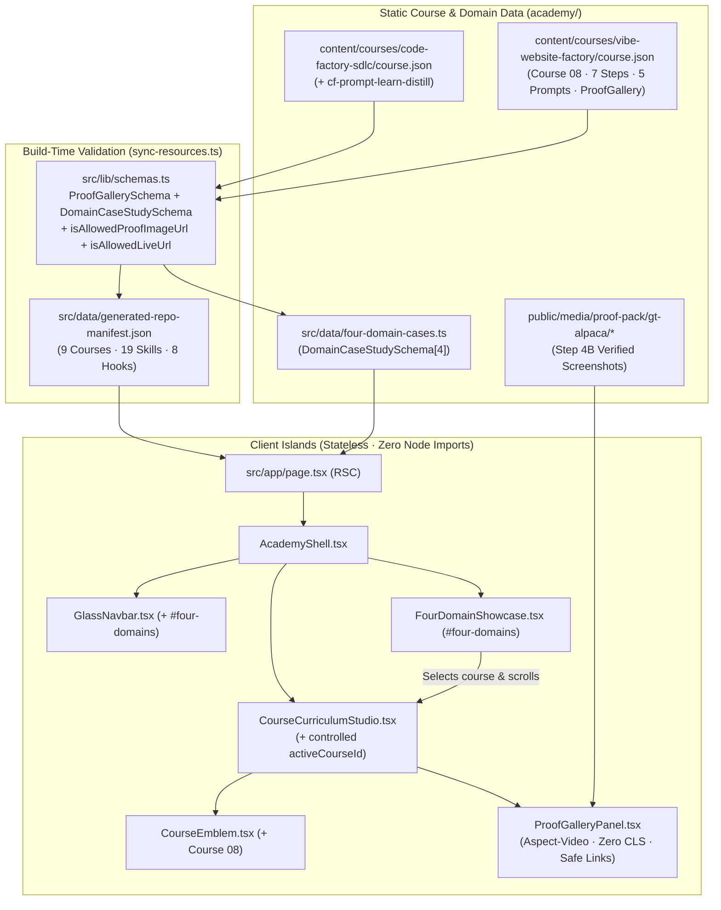
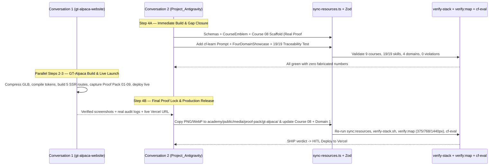

# Feature Spec: Academy Course 08 (`vibe-website-factory`), Proof Pack Gallery, 19/19 Skill Gap Closure & 4-Domain Showcase

**Status:** Locked — Approved for Stage 3 Execution  
**Date:** 2026-11-26  
**Research & Context Inputs:**  
- [`.memory/architecture.md`](file:///Users/ralphb/Projects_Personal/Project_Antigravity/.memory/architecture.md)  
- [`.memory/feature-map.md`](file:///Users/ralphb/Projects_Personal/Project_Antigravity/.memory/feature-map.md)  
- [`.agents/rules/academy-invariants.md`](file:///Users/ralphb/Projects_Personal/Project_Antigravity/.agents/rules/academy-invariants.md)  
- [`skills/cf-website-factory/SKILL.md`](file:///Users/ralphb/Projects_Personal/Project_Antigravity/skills/cf-website-factory/SKILL.md)  
- [`/Users/ralphb/Projects_Personal/gt-alpaca-website/.memory/research.md`](file:///Users/ralphb/Projects_Personal/gt-alpaca-website/.memory/research.md)  
- [`/Users/ralphb/Projects_Personal/gt-alpaca-website/proof-pack/01-bootstrap.txt`](file:///Users/ralphb/Projects_Personal/gt-alpaca-website/proof-pack/01-bootstrap.txt)  
**Related ADR:** [`.memory/decisions/0007-academy-proof-gallery-and-four-domain-method.md`](file:///Users/ralphb/Projects_Personal/Project_Antigravity/.memory/decisions/0007-academy-proof-gallery-and-four-domain-method.md)

---

## 1. Overview, Goals & Explicit Non-Goals

### Problem Statement
`code-factory` `v3.0.0` provides **19 progressive-disclosure skills**, yet Antigravity Academy (`academy/`, currently `8` courses `00–07`) exhibits three structural gaps before Master Program completion:
1. **Website Factory Training & Prompt Gap:** The four `v2.5.0` skills (`cf-website-factory`, `cf-design-tokens`, `cf-threejs-craft`, `cf-geo-seo`) have zero curriculum steps and zero Prompt Vault cards, and `LessonStepSchema` lacks an allowlisted `proofGallery` contract for embedding verifiable stage-by-stage Proof Pack `01–09` evidence from `/Users/ralphb/Projects_Personal/gt-alpaca-website`.
2. **19/19 Prompt Vault Gap:** `cf-learn` appears only inside a compound `skillRef: "cf-learn + cf-handover"` card (`cf-prompt-learn-and-add-course` in Course 02), leaving `14/19` skills with standalone Prompt Vault cards prior to Course 08.
3. **4-Domain Method Showcase Gap:** The Academy homepage lacks a unified `#four-domains` showcase proving the Code Factory method across all four real shipped domains (**Website**, **Mobile/Web 3D Game**, **Video Generation**, and **Application & Harness Development**) with verified facts and direct links to matching courses and live deployments.

### Goals
1. **Allowlisted `ProofGallerySchema` & `ProofGalleryPanel.tsx`:** Extend `LessonStepSchema` cleanly (`proofGallery` optional; 100% backward compatible with Courses `00–07`) with strict `isAllowedProofImageUrl` and `isAllowedLiveUrl` guards, accessible `CLS = 0` proof cards, and Course Curriculum Studio rendering.
2. **Course 08 (`vibe-website-factory`) + Custom Emblem + Two-Phase Proof Protocol:** Publish `academy/content/courses/vibe-website-factory/course.json` (`number: 8`, `7` ELI5 + Pro steps mapped to all `6` Website Factory stages and Proof Pack `01–09`, `5` Prompt Vault cards, custom Course `08` emblem in `CourseEmblem.tsx`, and bespoke studio illustration) using strictly honest data in **Step 4A** and ingesting final `gt-alpaca-website` screenshots + live metrics in **Step 4B**.
3. **19/19 Skill Gap Closure & 4-Domain Proven Method Showcase:** Add dedicated `cf-prompt-learn-distill` (`skillRef: "cf-learn"`) to Course 02, ship `FourDomainShowcase.tsx` + `four-domain-cases.ts` wired via `page.tsx` → `AcademyShell.tsx` (`#four-domains` tracked in `.memory/feature-map.md`), and enforce a filesystem-backed **19/19 Skill Traceability & 4-Domain Regression Test** in `academy/tests/schemas-and-prompts.test.ts`.

### Explicit Non-Goals
- **Zero Auth / Database / Runtime API Changes:** `academy/` remains strictly stateless (`localStorage` + Zod). Zero Postgres tables, RLS policies, cookies, or user logins added.
- **Zero New Dependencies:** Zero npm or PyPI packages added to root or `academy/`. Uses existing Next.js (`next/image`), Tailwind CSS v4 `@theme` tokens, Lucide icons, Zod v4, and Mermaid (`securityLevel: "strict"`, `htmlLabels: false`).
- **Zero Root Plugin Changes:** Do not alter `plugin.json`, `hooks.json`, `rules/AGENTS.md`, `skills/`, or `hooks/`.
- **Zero Fabricated Metrics:** Never invent Lighthouse scores, compressed byte savings, draw-call numbers, or mock PNGs for `gt-alpaca-website` during Step 4A before Steps 2–3 execute in `/Users/ralphb/Projects_Personal/gt-alpaca-website`.

---

## 2. System Architecture & Runtime Boundaries

### Component & Data-Flow Diagram



### Two-Phase Proof Ingestion & Verification Sequence



### Serverless & Boundary Guarantees
- **Vercel / Next.js Boundary:** `academy/src/components/**` imports strictly client-safe modules (`react`, `next/image`, `lucide-react`, `@/lib/schemas`, `@/lib/contracts`). `academy/.dependency-cruiser.cjs` (`no-server-or-db-in-ui`, `no-lib-importing-app-or-ui`, `no-circular`) remains 100% green.
- **Vercel Deployment Tracing:** `academy/.vercelignore` excludes `tests`, `.next`, `coverage`, and `.env*`, while preserving `public/media/proof-pack/**` and `src/data/generated-repo-manifest.json` (`next.config.ts` `outputFileTracingIncludes`).
- **Existing API Routes Unchanged:** `GET /api/courses` (`maxDuration = 10`, `PaginationQuerySchema` default `20` / max `100`) automatically serves all `9` courses (`0..8`) sorted ascending; `GET /api/resources` and `POST /api/hitl/simulate` require zero code changes.

---

## 3. Typed Contracts & Runtime Validation Schemas (`academy/src/lib/schemas.ts`)

Add the following exports to `academy/src/lib/schemas.ts` (**Task 0**), preserving 100% backward compatibility with Courses `00–07`:

```ts
/**
 * Explicit allowlist for local Proof Pack screenshots (Security Invariant).
 * Restricts paths strictly to /media/proof-pack/<project-slug>/<filename>.<ext>
 * and blocks directory traversal, remote hosts, and javascript:/data: URIs.
 */
export const ALLOWED_PROOF_IMAGE_URL_PATTERNS: readonly RegExp[] = [
  /^\/media\/proof-pack\/[a-z0-9-]+\/[A-Za-z0-9._-]+\.(?:png|webp|jpg|jpeg|svg)$/,
];

export function isAllowedProofImageUrl(url: string): boolean {
  if (!url || url.includes("..")) return false;
  return ALLOWED_PROOF_IMAGE_URL_PATTERNS.some((pattern) => pattern.test(url));
}

/**
 * Explicit allowlist for external live demo URLs (Security Invariant).
 * Permits strictly https:// origins without whitespace or embedded credentials.
 */
export function isAllowedLiveUrl(url: string): boolean {
  if (!url || url.length > 500 || /\s/.test(url)) return false;
  if (!/^https:\/\/[A-Za-z0-9.-]+(?:\/[^\s]*)?$/.test(url)) return false;
  try {
    const parsed = new URL(url);
    return (
      parsed.protocol === "https:" &&
      parsed.hostname.length > 0 &&
      !parsed.username &&
      !parsed.password
    );
  } catch {
    return false;
  }
}

export const ProofMetricSchema = z.object({
  label: z.string().min(1).max(80),
  before: z.string().min(1).max(80).optional(),
  after: z.string().min(1).max(120),
  status: z.enum(["pass", "info"]),
});

export const ProofArtifactSchema = z
  .object({
    id: z.string().regex(/^[a-z0-9-]+$/).max(80),
    label: z.string().min(1).max(120),
    imageSrc: z
      .string()
      .refine(isAllowedProofImageUrl, {
        message:
          "Proof imageSrc must match /media/proof-pack/<project-slug>/<filename>.(png|webp|jpg|jpeg|svg).",
      })
      .optional(),
    alt: z.string().min(1).max(280).optional(),
    caption: z.string().min(1).max(300),
    command: z.string().min(1).max(240).optional(),
    cliExcerpt: z.string().min(1).max(2000).optional(),
  })
  .superRefine((val, ctx) => {
    if (val.imageSrc && !val.alt) {
      ctx.addIssue({
        code: "custom",
        path: ["alt"],
        message: "Proof artifact requires accessible alt text whenever imageSrc is provided.",
      });
    }
  });

export const ProofGallerySchema = z.object({
  title: z.string().min(1).max(160),
  summary: z.string().min(1).max(600),
  pipelinePhase: z.string().min(1).max(80),
  skillsUsed: z.array(z.string().min(1).max(60)).min(1).max(20),
  promptsVerified: z.array(z.string().min(1).max(120)).default([]),
  metrics: z.array(ProofMetricSchema).default([]),
  artifacts: z.array(ProofArtifactSchema).min(1).max(16),
  liveUrl: z
    .string()
    .refine(isAllowedLiveUrl, {
      message: "Proof liveUrl must use a valid https:// origin.",
    })
    .optional(),
});

export const DomainIdSchema = z.enum(["website", "game", "video", "harness"]);

export const DomainCaseStudySchema = z.object({
  id: DomainIdSchema,
  order: z.number().int().min(1).max(4),
  domainLabel: z.string().min(1).max(40),
  title: z.string().min(1).max(120),
  eli5Title: z.string().min(1).max(120),
  repoName: z.string().min(1).max(80),
  status: z.enum(["shipped", "in-progress"]),
  accentTone: z.enum(["amber", "emerald", "rose", "cyan"]),
  summary: z.string().min(1).max(400),
  eli5Summary: z.string().min(1).max(400),
  stack: z.array(z.string().min(1).max(60)).min(2).max(10),
  skillsApplied: z.array(z.string().min(1).max(40)).min(2).max(12),
  verifiedMetrics: z
    .array(
      z.object({
        label: z.string().min(1).max(60),
        value: z.string().min(1).max(80),
      }),
    )
    .min(2)
    .max(6),
  proofArtifactPath: z.string().min(1).max(160),
  liveUrl: z
    .string()
    .refine(isAllowedLiveUrl, {
      message: "Domain liveUrl must use a valid https:// origin.",
    })
    .optional(),
  linkedCourseSlug: z.string().regex(/^[a-z0-9-]+$/).optional(),
  linkedCourseNumber: z.number().int().min(0).optional(),
});
```

### Schema Extensions (`LessonStepSchema` & Exported Types)
- Extend `LessonStepSchema` with `proofGallery: ProofGallerySchema.optional()`.
- Export inferred TypeScript types: `ProofMetric`, `ProofArtifact`, `ProofGallery`, `DomainId`, `DomainCaseStudy`.
- Update `AcademyShellProps` in `academy/src/lib/contracts.ts` with `domainCases?: DomainCaseStudy[];` (optional default `[]` so any isolated component/test callers remain unbroken while `src/app/page.tsx` passes `FOUR_DOMAIN_CASES`).

---

## 4. UI Components, Course 08 Curriculum & Two-Phase Proof Protocol

### 4.1 `ProofGalleryPanel.tsx` (`academy/src/components/ProofGalleryPanel.tsx`)
- **Placement:** Rendered inside `CourseCurriculumStudio.tsx` inside the expanded step body (`id={`step-body-${step.id}`}`) directly below `<Eli5MicrolearningCard />` (or classic view) whenever `step.proofGallery` is defined—ensuring proof evidence is immediately visible in both `"eli5"` and `"pro"` modes.
- **Props:**
  ```ts
  export interface ProofGalleryPanelProps {
    gallery: ProofGallery;
    stepId: string;
  }
  ```
- **Visual, WCAG 2.1 AA & `CLS = 0` Spec:**
  1. **Tokens Only:** Strictly use `@theme` tokens (`glass-panel`, `bg-void-950`, `bg-void-900/80`, `border-glass-border-strong`, `text-ink-primary`, `text-ink-secondary`, `text-ink-muted`, `text-emerald-glow`, `text-cyan-glow`, `text-amber-glow`, `text-rose-glow`, `bg-cyan-deep`). Zero literal hex values; zero `opacity-55`.
  2. **Header Strip:** Displays `pipelinePhase` pill, `gallery.title` (`h6`), `gallery.summary`, verified `skillsUsed[]` chips, `promptsVerified[]` count/chips, and an optional outbound `<a href={gallery.liveUrl} target="_blank" rel="noopener noreferrer">` CTA ONLY when `isAllowedLiveUrl(gallery.liveUrl)` returns `true` (if invalid in malformed props, render `role="alert"` `"Blocked Live URL"` instead of an anchor).
  3. **Metrics Strip:** Responsive grid (`grid-cols-1 gap-2.5 sm:grid-cols-2 lg:grid-cols-3`) rendering each `{ label, before?, after, status }` card with `status === "pass"` (`border-emerald-glow/40 text-emerald-glow`) vs. `status === "info"` (`border-amber-glow/40 text-amber-glow`, used cleanly for `"Pending Step 4B"` items).
  4. **Artifact Cards (`grid-cols-1 gap-4 md:grid-cols-2`):** Every artifact card reserves a fixed **`relative aspect-video w-full overflow-hidden rounded-xl border border-glass-border bg-void-950`** slot (`CLS = 0` across all 4 states):
     - **Image Ready State (`imageSrc` valid via `isAllowedProofImageUrl` & no load error):** Renders Next.js `<Image src={artifact.imageSrc} alt={artifact.alt ?? artifact.caption} fill sizes="(max-width: 768px) 100vw, 540px" unoptimized={artifact.imageSrc.endsWith(".svg")} className="object-cover" onError={() => markFailed(artifact.id)} />`.
     - **Blocked URL State (`imageSrc` fails `isAllowedProofImageUrl`):** Renders `role="alert"` warning card inside the `aspect-video` frame (zero network fetch).
     - **Image Error State (`onError`):** Renders `role="status"` `"Proof Preview Unavailable"` with `artifact.alt` / `caption` inside the `aspect-video` frame.
     - **CLI / Pending Proof State (`!artifact.imageSrc` — e.g. Proof `#01` text log or Step 4A pending screenshot):** Renders a crisp `cosmic-grid` terminal slate showing `artifact.label`, optional `command`, and `"Pending Step 4B Capture"` / CLI badge inside the exact `aspect-video` frame.
  5. **Expandable CLI Excerpt Drawer:** When `artifact.cliExcerpt` is defined, render `<button type="button" aria-expanded={open} aria-controls={`proof-cli-${stepId}-${artifact.id}`}>` toggling `<pre className="max-h-56 overflow-auto ..."><code>{artifact.cliExcerpt}</code></pre>` (keyboard focusable with global `:focus-visible`).

### 4.2 Course 08 Emblem (`academy/src/components/CourseEmblem.tsx`)
- Add `"vibe-website-factory"` as the 9th entry in `CanonicalCourseKey`, `COURSE_KEYS_BY_NUMBER`, and `COURSE_THEMES`:
  - **Semantic Theme:** `amber` family (`border-amber-glow/40 hover:border-amber-glow/85`, `activeBorderClass: "border-2 border-amber-glow"`, `topBarClass: "bg-gradient-to-r from-amber-glow via-emerald-glow to-cyan-glow"`, `badgeClass: "border-amber-glow/45 bg-amber-glow/15 text-amber-glow"`, `emblemContainerClass: "border-amber-glow/45 bg-gradient-to-br from-amber-glow/15 via-emerald-glow/10 to-cyan-glow/15"`, `iconColorClass: "text-amber-glow"`, `themeLabel: "Website Factory · Amber & Emerald"`).
  - **Custom SVG Artwork (`EmblemArtwork`):** Isometric 3D wireframe cube (`var(--color-cyan-glow)`) paired with a design-token swatch diamond (`var(--color-amber-glow)`) and GEO/AEO signal beacon arcs (`var(--color-emerald-glow)`, `var(--color-ink-primary)`). Zero hardcoded hex.

### 4.3 Course 08 Curriculum (`academy/content/courses/vibe-website-factory/course.json`)
- **Metadata:** `id: "vibe-website-factory"`, `slug: "vibe-website-factory"`, `number: 8`, `level: "all-levels"`, `estimatedMinutes: 60`, `threeScenePreset: "sdlc-orbital"`, `accentTone: "emerald"`, `illustration: { src: "/media/illustrations/vibe-website-factory-studio.jpg", alt: "...", caption: "...", visualAnalogy: "..." }`, `video: { provider: "coming_soon", ... }` (`6` chapters covering Stages `0–5` & Proof Pack `01–09`).
- **7-Point ELI5 Readability Rubric Mandatory on All 7 Steps:**
  - Every step provides `plainTitle`, `oneLineHook`, physical `everydayAnalogy` (`<= 160` chars), distinct 4-part cards (`simpleExplanation`, `whyItMatters`, `roleInProtocol`, `howToUseGoingForward`), `whenToUse`, `realWorldExample`, `audioScript` (`75–180` words with **zero** markdown `**`, backticks `` ` ``, `#`, or URLs), and plain-English quoted-label `mermaidDiagram` with **zero** HTML tags (`<br/>`, `<b>`).
- **7-Step Mapping to `cf-website-factory` Stages & GT-Alpaca Proof Pack `01–09`:**

| Step | Title & Stage | Primary Skills Covered | Linked Prompt (`promptId`) | Proof Pack Slots Mapped |
| :-: | :--- | :--- | :--- | :--- |
| **1** | Bootstrap, Grounded Research & Creative Brief (Stages 0–1) | `cf-website-factory`, `cf-bootstrap`, `cf-research`, `cf-grill-me` | `vwf-prompt-website-factory` | **`01-bootstrap`** (Real `01-bootstrap.txt` tree + verified source counts: `22` alpacas, `7` Ibiza routes, `23` tracks, `4.5 MB` raw `avalon_poc.glb`) |
| **2** | 3-Layer W3C Design Tokens & Build-Time WCAG >= 4.5:1 (Stage 2A) | `cf-design-tokens` | `vwf-prompt-design-tokens` | **`03-tokens-wcag`** (`generate-tokens.mjs` + `validate-tokens.mjs` contrast & polarity proof) |
| **3** | Zero-Native-Binary GLB Compression & Mobile 3D Craft (Stage 2B) | `cf-threejs-craft` | `vwf-prompt-threejs-craft` | **`02-glb-compression`** (`4.5 MB` raw `before` verified → Step 4B compressed `after`) + **`04-threejs-audit`** (`audit-threejs.mjs`) |
| **4** | Partitioned Swarm Build & Tri-Layer GEO / AEO / SEO (Stage 3) | `cf-geo-seo`, `cf-implement` | `vwf-prompt-geo-seo` | **`05-geo-seo-audit`** (SSR HTML outside `<canvas>`, AI `robots.txt`, JSON-LD `@graph`, `audit-geo-seo.mjs`) |
| **5** | Full-Stack Gates & 3-Viewport Feature Map Check (Stage 4A) | `cf-next-verify`, `cf-verify-map` | `vwf-prompt-proof-pack-audit` | **`06-verify-stack`** (`tsc`, `eslint`, `vitest`, secrets, `depcruise`, `next build`) + **`07-verify-map-3viewports`** (`375px` / `768px` / `1440px`) |
| **6** | Decoupled Dual-Axis Evaluation & Answerability (Stage 4B) | `cf-eval`, `cf-qa-review` | `cf-prompt-trajectory-eval` | **`08-cf-eval-ship`** (Clean-context `cf-reviewer` Output + Trajectory `SHIP` scorecard) |
| **7** | HITL Live Launch, Smoke Tests & Proof Pack Assembly (Stage 5) | `cf-deploy-staging`, `cf-handover`, `cf-website-factory` | `vwf-prompt-website-factory` | **`09-live-launch-matrix`** (Live Vercel `https://` URL, `curl --max-time 5` smoke tests, prompt & phase completion matrix) |

- **5 Prompt Vault Cards (`prompts[0..4]` in Course 08 — each with `eli5Title` & `whenToUse`):**
  1. `vwf-prompt-website-factory` (`skillRef: "cf-website-factory"`, `stage: "spec"`, `difficulty: "intermediate"`) — Run full 6-stage `cf-website-factory` pipeline from Creative Brief through Proof Pack `01–09`.
  2. `vwf-prompt-design-tokens` (`skillRef: "cf-design-tokens"`, `stage: "architecture"`, `difficulty: "beginner"`) — Author 3-layer W3C `design/tokens.json`, compile Tailwind v4 `@theme inline` + WCAG `>= 4.5:1`, and pass `validate-tokens.mjs`.
  3. `vwf-prompt-threejs-craft` (`skillRef: "cf-threejs-craft"`, `stage: "build"`, `difficulty: "senior"`) — Compress `.glb` via `optimize-glb.mjs` (Meshopt + `KHR_mesh_quantization` + WebP), build R3F `<PerformanceMonitor>` + `Timer` + dev-only `lil-gui` + fallback, and pass `audit-threejs.mjs`.
  4. `vwf-prompt-geo-seo` (`skillRef: "cf-geo-seo"`, `stage: "build"`, `difficulty: "intermediate"`) — Build SSR crawlable pages, AI-permissive `robots.txt`, connected JSON-LD `@graph`, 40–60 word AEO answers, and pass `audit-geo-seo.mjs`.
  5. `vwf-prompt-proof-pack-audit` (`skillRef: "cf-website-factory"`, `stage: "test"`, `difficulty: "senior"`) — Run all 5 Website Factory gates, assemble numbered `proof-pack/01..09`, and invoke clean-context `cf-reviewer` (`cf-eval`).

### 4.4 Explicit Step 4A vs. Step 4B Proof Ingestion Protocol
- **Step 4A (Immediate — Zero Fabricated Data):**
  - Embed verified Proof `#01` (`gt-alpaca-website/proof-pack/01-bootstrap.txt` tree excerpt) and exact source facts verified from `gt-alpaca-website/.memory/research.md` (`4.5 MB` raw `avalon_poc.glb`, `22` real alpacas, `7` Ibiza routes, `23` local tracks, `45s` `60fps` trailer, `0` High/Critical CVE target).
  - For Proof Pack slots `02–09`, set `metrics[].status: "info"`, `metrics[].after: "Pending Step 4B (after gt-alpaca-website Steps 2–3)"`, omit `imageSrc` (rendering clean `aspect-video` CLI/Pending cards), and omit `liveUrl` on Step 7 until the live Vercel URL exists.
- **Step 4B (Post-GT-Alpaca Launch — Surgical Data Ingestion):**
  - Only after `/Users/ralphb/Projects_Personal/gt-alpaca-website` completes Steps 2–3 and records real outputs in `gt-alpaca-website/proof-pack/`:
    1. Copy verified PNG/WebP screenshots from `/Users/ralphb/Projects_Personal/gt-alpaca-website/proof-pack/` into `academy/public/media/proof-pack/gt-alpaca/` (normalized lowercase kebab filenames matching `isAllowedProofImageUrl`).
    2. Update ONLY `academy/content/courses/vibe-website-factory/course.json` (`metrics[]`, `imageSrc` + descriptive `alt`, `cliExcerpt`, and `liveUrl`) and `academy/src/data/four-domain-cases.ts` (Domain 1 `status: "shipped"`, real metrics, real `liveUrl`).
    3. Clear `academy/.next/cache/images/`, re-run `cd academy && pnpm run sync:resources`, and run the full Verification Oracles (§6) before live Academy deploy.

---

## 5. Step 5: 19/19 Skill Gap Closure & 4-Domain Showcase

### 5.1 Dedicated `cf-learn` Prompt Card (`academy/content/courses/code-factory-sdlc/course.json`)
- Append `cf-prompt-learn-distill` to `prompts[]` (preserving all 11 existing Course 02 prompts intact):
  - `id`: `"cf-prompt-learn-distill"`
  - `title`: `"Distill a Resolved Bug Into a Permanent Rule & Regression Test (cf-learn)"`
  - `eli5Title`: `"Turn a Fixed Bug Into a Permanent House Rule So It Never Returns"`
  - `stage`: `"optimise"`
  - `difficulty`: `"intermediate"`
  - `skillRef`: `"cf-learn"`
  - `whenToUse`: `"Copy this right after fixing any tricky bug, UI glitch, or security issue so you lock in one house rule and test preventing that failure forever."`
  - Parameterized variables: `{{incident_summary}}`, `{{root_cause_rule}}`, `{{rule_target_file}}` (default `.agents/rules/`), `{{regression_test_file}}`.

### 5.2 4-Domain Proven Method Showcase (`FourDomainShowcase.tsx` + `four-domain-cases.ts`)
- **Dataset (`academy/src/data/four-domain-cases.ts`):** Validated via `z.array(DomainCaseStudySchema).length(4).parse(...)` with strictly verified facts:
  1. **Domain 1 — Website (`id: "website"`, `order: 1`, `linkedCourseSlug: "vibe-website-factory"`, `linkedCourseNumber: 8`):** *The Herd of Ibiza: GT-Alpaca* (`gt-alpaca-website`) — Next.js SSR, 3-layer W3C `tokens.json` -> Tailwind v4, R3F/Three.js (`avalon_poc.glb`), GEO/AEO JSON-LD `@graph`, `22` alpacas / `7` routes / `23` tracks (`status: "in-progress"` in Step 4A -> `"shipped"` + live URL in Step 4B).
  2. **Domain 2 — Mobile / Web 3D Game (`id: "game"`, `order: 2`, `liveUrl: "https://www.alpacas-ibiza.app"`, `status: "shipped"`):** *The Herd of Ibiza: GT-Alpaca Edition* (`herd_and_co`) — Vite 7 + React 19 + Three.js (`0.180.0`), Vercel `/api/race` + Supabase leaderboard, `22` alpacas, `7` Ibiza routes, `23` local tracks, `build:poki` / `build:crazygames` HTML5 portal seam, Playwright verification (`verify:all` + `verify:sponsors`).
  3. **Domain 3 — Video Generation (`id: "video"`, `order: 3`, `linkedCourseSlug: "enterprise-product-video-studio"`, `linkedCourseNumber: 6`, `status: "shipped"`):** *Enterprise Product Video Studio* (`product-video-studio`) — Remotion 4 (`60 fps`), Metal GPU Playwright `canvas.captureStream(60)`, FFmpeg (`-14 LUFS`, `+faststart`), RMS beat-synced `16:9` (`24 MB` master / `12 MB` live Course 06 embed) & `9:16` (`22 MB` master) teasers.
  4. **Domain 4 — Application & Harness Development (`id: "harness"`, `order: 4`, `linkedCourseSlug: "code-factory-sdlc"`, `linkedCourseNumber: 2`, `liveUrl: "https://antigravity-academy-ten.vercel.app"`, `status: "shipped"`):** *Antigravity Academy + Enterprise Code Factory `v3.0.0`* (`Project_Antigravity` / `academy/`) — Pure Python 3 stdlib `5`-event lifecycle hooks (`8` hook resources), `19` progressive skills (`19/19` Prompt Vault coverage), `5` least-privilege personas, Next.js App Router + Tailwind v4 + Zod + Mermaid + `depcruise` + `cf-verify-map`, `139+` verified checks (`0` High/Critical CVEs).
- **UI Placement & Navigation (`AcademyShell.tsx`, `GlassNavbar.tsx`, `CourseCurriculumStudio.tsx`, `.memory/feature-map.md`):**
  - Mount `<FourDomainShowcase domainCases={domainCases} learningDepthMode={progress.learningDepthMode} onOpenCourse={handleOpenCourseById} />` inside `<section id="four-domains" aria-labelledby="four-domains-heading">` immediately below `<SdlcReferenceShowcase />` and above `<CourseCurriculumStudio />` (directly visible—NO fractional `whileInView` wrapper per `.agents/rules/academy-invariants.md`).
  - Clicking **"Open Course XX →"** sets `activeCourseId` in `AcademyShell` and smoothly scrolls to `#courses`.
  - Add `{ href: "#four-domains", label: "4 Domains" }` to `NAV_LINKS` in `GlassNavbar.tsx`.
  - Update `.memory/feature-map.md` in the same milestone: add `#four-domains` section, add `"#four-domains"` and `"#four-domains-heading"` to `targets[0].selectors`, and update Course Curriculum verification notes to `Courses 00–08` (`total: 9`).

### 5.3 Deterministic 19/19 Skill Traceability & 4-Domain Regression Test (`academy/tests/schemas-and-prompts.test.ts`)
- Reads every `skills/cf-*/SKILL.md` directly from `../../skills` (`>= 19` skills).
- Loads and `CourseSchema.parse`-validates every `academy/content/courses/*/course.json` (`>= 9` courses, `0..8`).
- Asserts that **100% (`19/19`)** of discovered skills have:
  1. **Prompt Vault Coverage:** At least one `PromptCard` with an exact standalone `skillRef === skillSlug` (and tokenized `+`-split membership).
  2. **Curriculum Coverage:** At least one `LessonStep` referencing `skillSlug` explicitly (via `repoArtifactPath`, step summary/takeaways/checklist/snippet/eli5, or linked `promptId`), and every defined `step.promptId` resolves to a real `PromptCard.id`.
- Validates `FOUR_DOMAIN_CASES` against `z.array(DomainCaseStudySchema).length(4)` confirming exact IDs `["website", "game", "video", "harness"]`, ascending `order: [1, 2, 3, 4]`, valid `https://` `liveUrl`s, and valid `linkedCourseSlug` references.

---

## 6. Selective Autonomy, Verification Oracles & Rollback Plan

### Selective Autonomy Matrix (`rules/AGENTS.md` §8)
| Workstream | Tier | Rationale |
| :--- | :--- | :--- |
| **Task 0** (`schemas.ts`, `contracts.ts`, `CourseEmblem.tsx`) | **Human-Lit** | Core Zod allowlist boundaries (`isAllowedProofImageUrl`, `isAllowedLiveUrl`) and shared props contracts |
| **Partition 1** (`ProofGalleryPanel.tsx`, `FourDomainShowcase.tsx`, `CourseCurriculumStudio.tsx`, `GlassNavbar.tsx`, `AcademyShell.tsx`) | **Lights-Out Build → Human-Lit Visual QA** | Bounded by `@theme` tokens, `depcruise`, Vitest, and 3-viewport `verify:map` + `browser` inspection |
| **Partition 2** (`four-domain-cases.ts`, `code-factory-sdlc/course.json`) | **Lights-Out** | Governed by `DomainCaseStudySchema`, `CourseSchema`, and 19/19 Skill Traceability Vitest gate |
| **Partition 3** (`vibe-website-factory/course.json` + studio illustration) | **Lights-Out → `cf-reviewer` Rubric** | Governed by `CourseSchema`, `mermaid.parse()`, and 7-point ELI5 Readability Rubric |
| **Partition 4** (`schemas-and-prompts.test.ts`, `api-routes.test.ts`, `components.test.tsx`, `.memory/feature-map.md`) | **Lights-Out (Decoupled)** | Deterministic test & Feature Map contract suite |
| **Stage 5 Production Deploy (`cf-deploy-staging`)** | **Human-Lit Mandatory** | Always gated by Stage 4 `.memory/qa-report.md` `SHIP` + explicit human approval |

### Deterministic Verification Oracles
1. `cd academy && pnpm run sync:resources` → `counts.skills: 19`, `counts.courses: 9`, zero `ZodError`.
2. `bash skills/cf-next-verify/scripts/verify-stack.sh academy --coverage` → **`6 passed, 0 failed`** (`tsc`, `eslint`, `vitest --coverage` incl. 19/19 Skill Traceability & ProofGallery tests, Static Boundary Scan `0` leaks, `depcruise` `0` violations, `next build` clean).
3. `node skills/cf-design-tokens/scripts/validate-tokens.mjs --dir academy/src` → **`0` literal `#hex` or arbitrary Tailwind spacing** (`0` `opacity-55` verified separately).
4. `cd academy && pnpm audit --audit-level=high` → **`0` High/Critical CVEs**.
5. `cd academy && pnpm run verify:map` (against `next start` on `http://localhost:3000`) → **`9/9` pass** across `375px`, `768px`, and `1440px` (`0` console/page/network errors, `0` missing selectors including `#four-domains`, `0px` horizontal overflow).
6. **Decoupled `cf-reviewer` (`cf-eval`) + Live `browser` Subagent:** Audit all diffs, 7-point ELI5 Readability Rubric on Course 08, real Proof Pack image integrity on disk, and 3-viewport visual inspection → explicit **`SHIP`** recorded in `.memory/qa-report.md`.

### Concrete Rollback Plan
- **Git Rollback (Local / Pre-Push):** `git revert <commit-sha>` cleanly restores 8 courses and `v3.0.0` baseline (zero DB or root-plugin changes). Pre-commit, revert tracked edits via `git checkout -- academy/ .memory/feature-map.md` and remove untracked `academy/content/courses/vibe-website-factory/`, `academy/public/media/illustrations/vibe-website-factory-studio.jpg`, `academy/public/media/proof-pack/gt-alpaca/`, `academy/src/components/{ProofGalleryPanel,FourDomainShowcase}.tsx`, and `academy/src/data/four-domain-cases.ts`.
- **Production Vercel Rollback:** `cd academy && vercel rollback https://antigravity-academy-ten.vercel.app --yes --scope nexite-os` (or exact prior deployment URL recorded in `.memory/handover.md` prior to deploy).

---

## 7. Atomic `/teamwork` Parallel File Ownership Matrix

Execute **Task 0** sequentially first; run **Partitions 1, 2, and 3** in parallel (`3` concurrent workers `<= 5` cap, zero overlapping files); run **Coordinator Synthesis** (`page.tsx` wire + `sync:resources`); run **Partition 4 (`cf-tester`)**; then invoke decoupled **Stage 4 (`cf-reviewer` + `browser`)**.

| Phase / Worker | Exclusive Owned Files (Allowed to Edit / Create) | Explicitly Forbidden Files |
| :--- | :--- | :--- |
| **Task 0 (`Coordinator` Prerequisite)** | `academy/src/lib/schemas.ts`, `academy/src/lib/contracts.ts`, `academy/src/components/CourseEmblem.tsx` | Do not edit UI panels, `page.tsx`, courses, `four-domain-cases.ts`, or tests yet |
| **Partition 1 (`cf-frontend` — UI)** | `academy/src/components/ProofGalleryPanel.tsx`, `academy/src/components/FourDomainShowcase.tsx`, `academy/src/components/CourseCurriculumStudio.tsx`, `academy/src/components/GlassNavbar.tsx`, `academy/src/components/AcademyShell.tsx` | `academy/src/lib/**`, `academy/src/data/**`, `academy/src/app/page.tsx`, `academy/content/**`, `academy/tests/**`, `academy/public/**` |
| **Partition 2 (`cf-backend` / Data & Gap)** | `academy/src/data/four-domain-cases.ts`, `academy/content/courses/code-factory-sdlc/course.json` | `academy/src/components/**`, `academy/src/lib/**`, `academy/src/app/page.tsx`, `academy/content/courses/vibe-website-factory/**`, `academy/tests/**` |
| **Partition 3 (`Curriculum + image-generator`)** | `academy/content/courses/vibe-website-factory/course.json`, `academy/public/media/illustrations/vibe-website-factory-studio.jpg` | `academy/src/**`, `academy/content/courses/code-factory-sdlc/**`, `academy/tests/**`, `academy/src/data/generated-repo-manifest.json` |
| **Coordinator Synthesis (Post-Wave)** | `academy/src/app/page.tsx` (pass `domainCases={FOUR_DOMAIN_CASES}`), run `cd academy && pnpm run sync:resources` ONCE | Do not modify tests or `.memory/feature-map.md` |
| **Partition 4 (`cf-tester` — Post-Synthesis)** | `academy/tests/schemas-and-prompts.test.ts`, `academy/tests/api-routes.test.ts`, `academy/tests/components.test.tsx`, `.memory/feature-map.md` | All source components, `schemas.ts`, `four-domain-cases.ts`, `course.json` files (report defects instead of editing source) |
| **Stage 4 QA (`cf-reviewer` + `browser`)** | `.memory/qa-report.md` (read-only audit + 3-viewport live browser QA) | All code, course, test, and asset files |
| **Step 4B (Post-GT-Alpaca Launch Ingestion)** | `academy/public/media/proof-pack/gt-alpaca/*`, `academy/content/courses/vibe-website-factory/course.json` (real metrics/screenshots/URL), `academy/src/data/four-domain-cases.ts` (Domain 1 real status/metrics/URL), then re-run `sync:resources` + QA | All UI components, schemas, and unrelated courses `00–07` |

---

## 8. Senior Engineer Sign-Off Gate Checklist

- [x] Allowlisted `ProofGallerySchema` (`isAllowedProofImageUrl`, `isAllowedLiveUrl`), optional backward-compatible `LessonStepSchema.proofGallery`, and `DomainCaseStudySchema` contracts are fully locked.
- [x] Course 08 (`vibe-website-factory`, `7` steps, `5` Prompt Vault cards, custom emblem, 7-point ELI5 rubric) and Step 4A vs. Step 4B zero-fabrication ingestion protocol are unambiguous.
- [x] `cf-learn` Prompt Vault gap closure (`cf-prompt-learn-distill`), `#four-domains` showcase, `.memory/feature-map.md` update, and filesystem-backed 19/19 Skill Traceability test are specified.
- [x] `/teamwork` Task 0 + Partitions 1–4 are 100% disjoint with zero concurrent file overlap.
- [x] Ready for Senior Engineer approval (`cf-implement` Stage 3).
