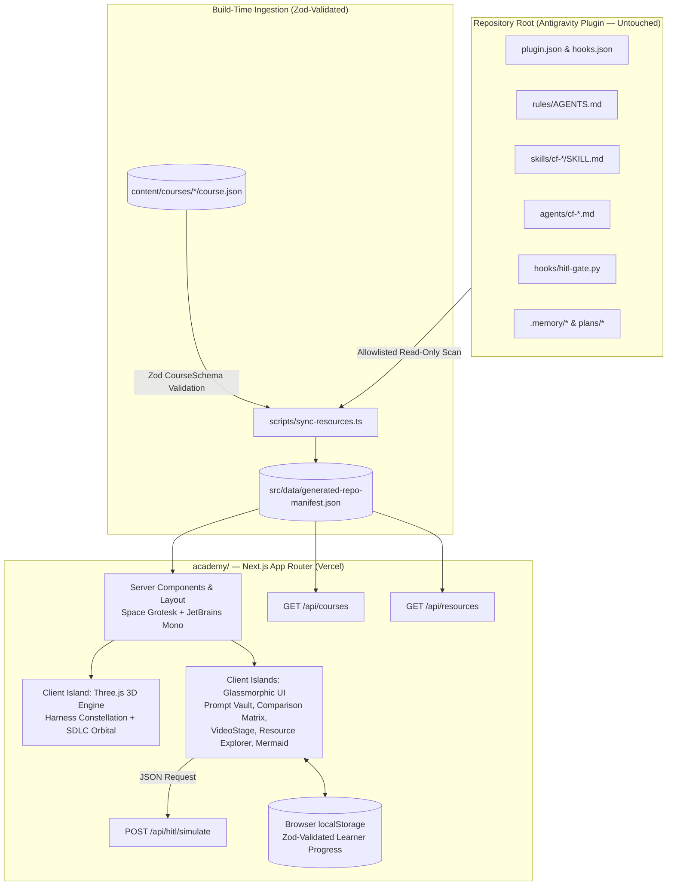
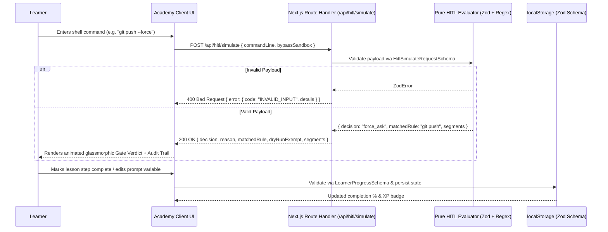

# Feature Spec: Antigravity Academy — Interactive Glassmorphic Learning & Showcase Platform

**Status:** Locked (Approved — 2026-11-24)  
**Date:** 2026-11-24  
**Research Input:** `.memory/research.md`, `.memory/research-academy-platform.md`  
**ADR Reference:** `.memory/decisions/0002-academy-nextjs-glassmorphic-architecture.md`

---

## 1. Overview & Goals

### Problem Statement
Engineers learning AI-assisted software engineering need more than static markdown guides—they need an interactive, studio-grade, hands-on training environment that teaches **how to master Google Antigravity as an engineering harness**, explains how Antigravity compares to Claude Code and how to plug its gaps, exposes **every real skill, rule, agent persona, safety hook, and SDLC artifact** from this repository, and lets learners copy customizable prompts and experience concepts through live 3D visualizers, diagrams, simulations, and video lessons.

### Target Users
1. **Beginners & Mid-Level Engineers:** Learning structured Spec-Driven Development (SDD), prompt engineering, lifecycle hooks, and AI-assisted full-stack workflows step by step.
2. **Senior / Staff Engineers:** Evaluating agent harness internals (Antigravity vs. Claude Code), inspecting invariant guardrails, testing HITL security regexes, and adopting Antigravity's multi-agent orchestration (`swarm`, `run_workflow`, `sidecars`).

### Success Criteria (v1)
1. **Isolated Next.js App Router Platform (`academy/`):** Zero interference with root Antigravity plugin discovery (`plugin.json`, `hooks.json`, `rules/`, `skills/`, `agents/`).
2. **Live Repo Auto-Sync:** Build-time script (`academy/scripts/sync-resources.ts`) ingests and Zod-validates all live repo resources (`rules/AGENTS.md`, 11 `skills/cf-*`, 4 `agents/cf-*`, `hooks/hitl-gate.py`, `.memory/*`, `plans/*`) into typed JSON so the platform stays synchronized with the repo.
3. **Extensible Multi-Course Registry:** Course modules stored as Zod-validated JSON bundles under `academy/content/courses/<slug>/course.json` so every future conversation in this repo can append a new course/lesson without modifying UI core code.
4. **Two Flagship Courses Pre-Loaded in v1:**
   - **Course 1:** *Mastering the Agent Harness: Antigravity vs. Claude Code & Plugging the Gaps* (interactive 12-dimension harness scorecard with "Raw Antigravity" vs. "Antigravity + Code Factory v3.0" toggle, live HITL Hook Simulator, copyable prompt library, Mermaid diagrams, and video stage).
   - **Course 2:** *The Enterprise Code Factory SDLC Reference Model* (interactive walkthrough of all 8 repeatable stages — Research, Spec, Architecture, Build, Test, Deploy, User Feedback, Optimise — directly linked to the live `.memory/` and `plans/` artifacts produced during this very build!).
5. **Futuristic Glassmorphic Design + Three.js 3D Visualizers:** Deep cosmic obsidian canvas, frosted multi-layer glass cards, electric cyan + plasma violet accents (`Space Grotesk` + `JetBrains Mono`), interactive Three.js 3D Agent Harness Constellation & 3D Orbital SDLC Factory Pipeline (with `prefers-reduced-motion`, IntersectionObserver pause, and WebGL fallback).
6. **Unified `VideoStage`:** Supports MP4/WebM + YouTube/Vimeo/Loom privacy-safe embeds, clickable chapter markers, transcript drawer, and polished glassmorphic placeholder cards ready for course recordings.
7. **Quality & Deployment:** 100% passing Vitest suite, clean TypeScript/ESLint/Next.js production build, independent `cf-reviewer` audit, live `browser` subagent visual audit at 375px / 768px / 1440px, and Vercel Staging Preview deployment in Stage 5.

### Explicit Non-Goals (v1)
- No server-side user authentication, login flows, or Postgres/Supabase database writes in v1 (deferred to v2; Next.js App Router is structured so Supabase Auth + RLS can be added cleanly later).
- No live arbitrary shell execution on the server (the HITL Hook Simulator evaluates commands purely via deterministic TypeScript port of `hooks/hitl-gate.py` regex rules—zero `child_process` invocation).

---

## 2. System Architecture

### Component & Boundary Diagram



### Request & Interaction Sequence (HITL Simulator + Course Progression)



---

## 3. API Contracts & Validation Schemas

All API Route Handlers live under `academy/src/app/api/`, export `export const maxDuration = 10;` (Vercel Function bound), validate all inputs via **Zod**, enforce explicit pagination bounds (`default limit=20`, `max limit=100`), never execute shell commands, and return consistent structured JSON envelopes.

### 3.1 Core Shared Zod Schemas (`academy/src/lib/schemas.ts`)

```ts
import { z } from "zod";

export const PaginationQuerySchema = z.object({
  limit: z.coerce.number().int().min(1).max(100).default(20),
  offset: z.coerce.number().int().min(0).default(0),
});

export const PromptVariableSchema = z.object({
  key: z.string().regex(/^[a-z0-9_]+$/),
  label: z.string().min(1).max(60),
  placeholder: z.string().max(120),
  defaultValue: z.string().max(200).default(""),
});

export const PromptCardSchema = z.object({
  id: z.string().min(1),
  title: z.string().min(1).max(120),
  stage: z.enum([
    "research", "spec", "architecture", "build",
    "test", "deploy", "feedback", "optimise", "meta",
  ]),
  difficulty: z.enum(["beginner", "intermediate", "senior"]),
  skillRef: z.string().optional(),
  description: z.string().min(1).max(400),
  template: z.string().min(1).max(4000),
  variables: z.array(PromptVariableSchema).default([]),
  expectedOutcome: z.string().min(1).max(400),
});

export const VideoChapterSchema = z.object({
  id: z.string().min(1),
  title: z.string().min(1).max(100),
  timestampSeconds: z.number().int().min(0),
  summary: z.string().max(240),
});

export const VideoConfigSchema = z.object({
  title: z.string().min(1).max(140),
  durationLabel: z.string().max(20),
  provider: z.enum(["mp4", "youtube", "vimeo", "loom", "coming_soon"]),
  embedUrl: z.string().url().optional(),
  posterLabel: z.string().max(160).optional(),
  chapters: z.array(VideoChapterSchema).default([]),
  transcriptSummary: z.string().max(2000).optional(),
});

export const LessonStepSchema = z.object({
  id: z.string().min(1),
  order: z.number().int().min(1),
  title: z.string().min(1).max(120),
  stageTag: z.string().min(1).max(40),
  summary: z.string().min(1).max(600),
  keyTakeaways: z.array(z.string().min(1)).min(1),
  actionChecklist: z.array(z.string().min(1)).min(1),
  codeSnippet: z.object({
    language: z.string(),
    filename: z.string(),
    code: z.string(),
  }).optional(),
  mermaidDiagram: z.string().optional(),
  repoArtifactPath: z.string().optional(),
  promptId: z.string().optional(),
});

export const CourseSchema = z.object({
  id: z.string().regex(/^[a-z0-9-]+$/),
  slug: z.string().regex(/^[a-z0-9-]+$/),
  number: z.number().int().min(1),
  title: z.string().min(1).max(140),
  subtitle: z.string().min(1).max(260),
  level: z.enum(["beginner", "intermediate", "senior", "all-levels"]),
  estimatedMinutes: z.number().int().min(5).max(600),
  threeScenePreset: z.enum(["harness-constellation", "sdlc-orbital", "hook-pipeline"]),
  accentTone: z.enum(["cyan", "violet", "emerald"]),
  tags: z.array(z.string().min(1)).min(1),
  video: VideoConfigSchema,
  steps: z.array(LessonStepSchema).min(1),
  prompts: z.array(PromptCardSchema).default([]),
});

export const RepoResourceSchema = z.object({
  id: z.string().min(1),
  category: z.enum(["rule", "skill", "agent", "hook", "memory", "plan", "manifest"]),
  name: z.string().min(1),
  relativePath: z.string().min(1),
  summary: z.string(),
  content: z.string(),
  sizeBytes: z.number().int().nonnegative(),
  stageRef: z.string().optional(),
});

export const HitlSimulateRequestSchema = z.object({
  commandLine: z.string().min(1, "Command line is required").max(1000, "Command exceeds 1000 chars"),
  bypassSandbox: z.boolean().optional().default(false),
});

export const HitlSimulateResponseSchema = z.object({
  decision: z.enum(["allow", "ask", "force_ask", "deny"]),
  reason: z.string(),
  matchedRule: z.string().nullable(),
  dryRunExempt: z.boolean(),
  segments: z.array(z.object({
    segment: z.string(),
    isDryRun: z.boolean(),
    matchedRule: z.string().nullable(),
    decision: z.enum(["allow", "ask", "force_ask", "deny"]),
  })),
});
```

### 3.2 Route Handler Endpoints

| Endpoint | Method | Auth Policy (v1) | Query / Body Schema | Success Response | Error Codes |
| :--- | :--- | :--- | :--- | :--- | :--- |
| `/api/courses` | `GET` | Public read-only (static learning catalog) | `PaginationQuerySchema` + optional `level`, `tag` | `200 OK`: `{ items: Course[], total, limit, offset }` | `400 INVALID_QUERY`, `500 INTERNAL_ERROR` |
| `/api/resources` | `GET` | Public read-only (allowlisted repo docs only) | `PaginationQuerySchema` + optional `category`, `q` (max 80 chars) | `200 OK`: `{ items: RepoResource[], total, limit, offset, syncedAt }` | `400 INVALID_QUERY`, `500 INTERNAL_ERROR` |
| `/api/hitl/simulate` | `POST` | Public stateless pure evaluator (no shell execution; input capped at 1000 chars) | `HitlSimulateRequestSchema` | `200 OK`: `HitlSimulateResponse` | `400 INVALID_INPUT` (Zod issues), `415 UNSUPPORTED_MEDIA_TYPE`, `500 INTERNAL_ERROR` |

### 3.3 Video Embed URL Allowlist (Security Invariant)
In `VideoStage` and `VideoConfigSchema`, external `embedUrl` values MUST match an explicit allowlist regex (`https://www.youtube-nocookie.com/embed/...`, `https://player.vimeo.com/video/...`, `https://www.loom.com/embed/...`, or local `/media/*.mp4|webm`). Any non-matching URL is rejected at validation time and rendered in the safe Error state.

---

## 4. Database & State Changes

### v1 Stateless Client Persistence (`localStorage`)
- **Storage Key:** `antigravity_academy_progress_v1`
- **Schema (`LearnerProgressSchema`):**
  ```ts
  {
    schemaVersion: 1,
    completedStepIds: string[],       // deduplicated step IDs
    bookmarkedPromptIds: string[],
    promptVariableValues: Record<string, Record<string, string>>,
    activeHarnessMode: "raw" | "code-factory-v3",
    updatedAt: string                 // ISO-8601
  }
  ```
- **Resilience:** All reads pass through `LearnerProgressSchema.safeParse()`. Corrupted or unknown-version payloads reset gracefully to defaults without crashing UI. Includes JSON Export / Import controls with Zod validation so learners can back up or transfer progress.

### v2 Forward-Compatibility Note (Not Implemented in v1)
- When multi-device accounts are introduced in v2, add Supabase Auth + Postgres tables `learner_profiles` and `course_progress` with mandatory `ENABLE ROW LEVEL SECURITY` (`auth.uid() = user_id`), composite unique index `(user_id, step_id)`, and an authenticated `/api/progress` Route Handler.

---

## 5. UI/UX & Accessibility Specs

### 5.1 Brand & Glassmorphic Design Token System (`academy/src/app/globals.css`)
All visual styling uses Tailwind CSS v4 `@theme` design tokens—zero raw hex colors or magic spacing inside component markup:
- **Canvas & Surfaces:**
  - `--color-void-950: #040712` (deep cosmic background)
  - `--color-void-900: #090E1F` (elevated canvas)
  - `--color-glass-surface: rgba(12, 19, 38, 0.76)` (frosted glass base ensuring ≥ 7:1 contrast with foreground text)
  - `--color-glass-elevated: rgba(18, 28, 56, 0.84)`
  - `--color-glass-border: rgba(148, 163, 184, 0.20)`
  - `--color-glass-highlight: rgba(56, 189, 248, 0.38)`
- **Luminous Accents:**
  - `--color-cyan-glow: #38BDF8` (primary Antigravity plasma cyan)
  - `--color-violet-glow: #A78BFA` (orchestration/swarm violet)
  - `--color-emerald-glow: #34D399` (verified/passing gate green)
  - `--color-amber-glow: #FBBF24` (`ask`/`force_ask` HITL warning)
  - `--color-rose-glow: #FB7185` (`deny`/blocking defect red)
- **Foreground Typography (WCAG 2.1 AA Verified):**
  - `--color-ink-primary: #F8FAFC` (> 14:1 on `--color-glass-surface`)
  - `--color-ink-secondary: #CBD5E1` (> 9:1 on `--color-glass-surface`)
  - `--color-ink-muted: #94A3B8` (> 5.2:1 on `--color-glass-surface`)
- **Typography (`next/font/google`):**
  - Display & UI: `Space Grotesk` (`--font-sans`)
  - Code, Prompts & Telemetry: `JetBrains Mono` (`--font-mono`)

### 5.2 Three.js 3D Interactive Visualizers (Cutting-Edge Client Islands)
Loaded dynamically via `next/dynamic(..., { ssr: false })` with fixed height containers (zero CLS) and full WebGL/Reduced-Motion fallback:
1. **Hero & Course 1 — `HarnessConstellationScene`:**
   - Interactive 3D orbital agent harness graph in Three.js with instanced luminous starfield, custom glowing wireframe core (`Orchestrator`), 8 orbiting translucent glass/icosahedron subsystem nodes (`Swarm Board`, `run_workflow`, `Lifecycle Hooks`, `Terminal Sandbox`, `MCP Bridges`, `Browser Eye`, `.memory/ Vault`, `Sidecar Daemon`), animated spline energy packets flowing between nodes, pointer-parallax + drag-orbit camera, and clickable node selection that updates a synchronized glassmorphic telemetry HUD card!
   - Mode Toggle: Switch seamlessly in 3D between **"Raw Antigravity"** (highlights open gap nodes in amber pulse) and **"Antigravity + Code Factory v3.0"** (activates shield rings, hook bridges, and emerald/cyan harmony).
2. **Course 2 — `SdlcOrbitalScene`:**
   - Interactive 3D torus-knot / 8-node orbital factory loop representing the repeatable cycle (`Research → Spec → Architecture → Build → Test → Deploy → User Feedback → Optimise`). Clicking any 3D stage node (or accessible keyboard pill strip below the canvas) smoothly focuses the camera on that stage and syncs the stage explainer panel, real repo artifact preview, and copyable skill prompt.

### 5.3 Component Hierarchy & Interactive Sections
1. **`GlassNavbar`** — Sticky frosted navigation (`Overview`, `3D Harness Lab`, `Courses`, `Prompt Vault`, `Repo Explorer`, `SDLC Live Trail`) + learner progress ring + mobile drawer (375px).
2. **`HeroShowcase`** — Full-bleed Three.js `HarnessConstellationScene` backdrop + glassmorphic hero overlay, live stats ingested from repo (`11 Skills`, `4 Personas`, `6 Hook Events`, `8 SDLC Stages`), primary CTAs, and animated scroll indicator.
3. **`HarnessComparisonLab`** — Interactive 12-dimension Antigravity vs. Claude Code Matrix + animated SVG Radar/Scorecard comparing **Claude Code**, **Raw Antigravity**, and **Antigravity + Code Factory v3.0**, with category filters and expandable senior-engineer "How to Plug & Exceed" implementation drawers.
4. **`SdlcReferenceShowcase`** — Interactive 8-stage SDLC explorer (`Research` → `Optimise`) pairing the 3D `SdlcOrbitalScene` with the **actual live `.memory/` and `plans/` artifacts** produced in this repository plus Mermaid diagrams rendered safely via `mermaid` (`securityLevel: 'strict'`).
5. **`CourseCurriculumStudio`** — Tabbed/routed Course Selector (Course 1 & Course 2 + extensible "Add Course via Conversation" blueprint banner), unified **`VideoStage`** (chapters, transcript drawer, graceful placeholder/embed player), step-by-step guided lessons with completion checkboxes, inline code blocks, and linked prompts.
6. **`PromptVault`** — Searchable, filterable library of copyable prompts (`Beginner`, `Intermediate`, `Senior`) with live `{{variable}}` input fields that dynamically interpolate the prompt text, 1-click Copy with accessible `aria-live="polite"` toast, and Bookmark toggle.
7. **`RepoResourceExplorer` + `HitlGateSimulator`** — Filterable browser for every live repo file (`AGENTS.md`, `SKILL.md`, `cf-*.md`, `hitl-gate.py`, `.memory/*`) PLUS an interactive **HITL Safety Hook Simulator** backed by `POST /api/hitl/simulate` where learners test commands (`git push`, `rm -rf`, `wrangler deploy --dry-run`, `npm test`) and see exact segment-by-segment decisions.

### 5.4 Loading, Error, Empty States & WCAG 2.1 AA Matrix

| Component | Loading State | Error State | Empty State | Accessibility (WCAG 2.1 AA) |
| :--- | :--- | :--- | :--- | :--- |
| **Three.js 3D Canvases** | Fixed-height (`h-[420px] md:h-[520px]`) frosted shimmer skeleton (zero CLS) | Automatic graceful **Static Architectural Telemetry SVG Fallback** if WebGL context unavailable | N/A | `aria-label` description, keyboard-accessible node selector pills duplicating all 3D click targets, auto-freezes motion on `prefers-reduced-motion: reduce`. |
| **`VideoStage`** | Fixed `aspect-video` glassmorphic shimmer placeholder | Clear alert banner + "Retry / Open External Link" action if media fails or URL disallowed | Polished glassmorphic "Video Module Ready — Attach MP4 / YouTube / Loom URL" stage with interactive chapter preview | Explicit `<button>` controls, keyboard chapter navigation, `title` on iframes, accessible transcript toggle (`aria-expanded`). |
| **`MermaidDiagram`** | Fixed `min-h-[260px]` glass skeleton | Error alert with "View Raw Mermaid Source" toggle & Retry button | N/A | Descriptive `<figure>` + `<figcaption>`, strict XSS sanitization. |
| **`PromptVault` & `RepoResourceExplorer`** | Skeleton cards | Alert banner + Retry button | Glassmorphic Empty Card ("No matching prompts/resources") with "Clear Filters" button | Explicit `<label>` on search/filter inputs, `:focus-visible` cyan rings, `aria-live="polite"` copy confirmation. |
| **`HitlGateSimulator`** | Inline spinner on "Evaluate Command" button | Inline validation error linked via `aria-invalid` + `aria-describedby` | Preset quick-test chips (`git push`, `rm -rf /tmp`, `wrangler deploy --dry-run`, `npm test`) | Explicit `<label for="hitl-cmd">`, keyboard-submittable form, clear semantic color + icon + text verdict (never color-only). |

### 5.5 Responsive Breakpoints
- **Mobile (`375px`):** Single-column stacked glass cards, collapsible mobile drawer nav, compact 3D canvas (`h-[340px]`), horizontally scrollable filter chips, zero horizontal overflow.
- **Tablet (`768px`):** 2-column grids for Prompt Vault & Resource Explorer, side-by-side Video + Chapter list.
- **Desktop (`1440px`):** Full-width widescreen command-center grids (`max-w-7xl`), split 3D + Telemetry HUD layouts, sticky course sidebar.

---

## 6. Security, Scalability & Testing Checklist

- [ ] **Input Validation:** Every API Route Handler and `localStorage` read validates payloads via Zod (`HitlSimulateRequestSchema`, `PaginationQuerySchema`, `LearnerProgressSchema`).
- [ ] **Zero Secrets & Path Traversal Protection:** `sync-resources.ts` strictly reads allowlisted relative paths inside the repo root and verifies resolved paths stay within repo root; zero `NEXT_PUBLIC_*` secrets.
- [ ] **XSS & Injection Prevention:** Mermaid uses `securityLevel: 'strict'`; zero unescaped `dangerouslySetInnerHTML`; video embed URLs enforced against strict domain allowlist; zero shell execution in API routes.
- [ ] **Performance & Scalability:** Stateless Route Handlers with `export const maxDuration = 10;`; pagination enforced (`default=20`, `max=100`); Three.js caps DPR at 2 and pauses off-screen via `IntersectionObserver`.
- [ ] **Deterministic Unit Tests (Vitest):**
  - `hitlEvaluator.test.ts`: Parity tests matching all 5 test suites of Python `hooks/hitl-gate.py` (benign commands, `git -C repo push`, `--dry-run` exemptions, chained segments, `bypassSandbox`, invalid inputs).
  - `schemas.test.ts`: Course schema validation, prompt variable interpolation, video URL allowlist rejection, corrupted `localStorage` fallback.
  - `apiRoutes.test.ts`: Route handler unit tests covering happy path, pagination clamping, 400 validation failures, and empty search results.
  - `components.test.tsx`: PromptVault copy/interpolation, HitlGateSimulator states (Loading/Error/Verdict), VideoStage chapter switching & empty/error states, WCAG ARIA attributes.

---

## 7. Atomic Task Breakdown (Non-Overlapping File Partitions)

Execution follows strict Swarm file-partitioning rules: **Task 0 completes first**, then **Tasks 1, 2, 3, and 4** execute cleanly on non-overlapping directories with zero file contention.

- [ ] **Task 0 (Shared Interfaces & Project Scaffold — Prerequisite):**
  - `academy/package.json`, `academy/tsconfig.json`, `academy/next.config.ts`, `academy/vitest.config.ts`, `academy/eslint.config.mjs`, `academy/postcss.config.mjs`
  - `academy/src/lib/schemas.ts` (all shared Zod schemas & TypeScript types)
  - `academy/src/app/globals.css` (Tailwind v4 `@theme` glassmorphic design tokens, animations, focus-visible & reduced-motion utilities)
  - `academy/src/app/layout.tsx` (`Space Grotesk` + `JetBrains Mono` via `next/font/google`, metadata, dark cosmic body)

- [ ] **Task 1 (Backend, Data Ingestion, Pure HITL Evaluator & Course Content — `cf-backend` partition):**
  - `academy/scripts/sync-resources.ts` (allowlisted live repo scanner + Zod validator → `academy/src/data/generated-repo-manifest.json`)
  - `academy/content/courses/harness-mastery/course.json` (Course 1: Antigravity vs. Claude Code & Gap-Plugging — full concepts, 12-dimension dataset, diagrams, copyable prompts, video chapters)
  - `academy/content/courses/code-factory-sdlc/course.json` (Course 2: Enterprise Code Factory 8-Stage SDLC Reference Model — linked to live repo artifacts, skills, personas, prompts, video chapters)
  - `academy/src/data/harness-comparison.ts` (typed 12-dimension scorecard: Claude Code vs. Raw Antigravity vs. Antigravity + Code Factory v3.0)
  - `academy/src/lib/hitl-evaluator.ts` (deterministic TypeScript port of `hooks/hitl-gate.py`)
  - `academy/src/lib/prompt-engine.ts` (template interpolation + Zod-safe `localStorage` persistence helpers)
  - `academy/src/lib/repository.ts` (typed loader for generated repo manifest & courses with pagination/filtering)
  - `academy/src/app/api/courses/route.ts`, `academy/src/app/api/resources/route.ts`, `academy/src/app/api/hitl/simulate/route.ts`

- [ ] **Task 2 (Cutting-Edge Three.js 3D Engine & Visualizers — `cf-frontend` 3D partition):**
  - `academy/src/components/three/HarnessConstellationScene.tsx` (interactive 3D orbital agent harness graph, particle splines, Raw vs. Code Factory v3.0 shield mode, node click HUD sync, IntersectionObserver pause, `prefers-reduced-motion`, WebGL fallback)
  - `academy/src/components/three/SdlcOrbitalScene.tsx` (interactive 3D 8-stage repeating factory loop with camera focus transitions & keyboard-synced controls)
  - `academy/src/components/three/WebGLFallbackCard.tsx` (crisp SVG/glass fallback when WebGL is unavailable)

- [ ] **Task 3 (Glassmorphic UI Components, VideoStage, Prompt Vault, Mermaid & Main Page — `cf-frontend` UI partition):**
  - `academy/src/components/GlassNavbar.tsx`
  - `academy/src/components/HeroShowcase.tsx`
  - `academy/src/components/HarnessComparisonLab.tsx` (interactive 12-dimension matrix + animated SVG radar/bar visualization + Raw vs. Code Factory v3.0 toggle)
  - `academy/src/components/SdlcReferenceShowcase.tsx` (8-stage live repo artifact walkthrough + 3D orbital sync)
  - `academy/src/components/VideoStage.tsx` (MP4/YouTube/Vimeo/Loom/Coming-Soon player + clickable chapters + transcript accordion)
  - `academy/src/components/MermaidDiagram.tsx` (strict-sanitized Mermaid renderer with Loading/Error/Raw-Source fallback)
  - `academy/src/components/CourseCurriculumStudio.tsx` (multi-course navigator, step tracker, progress export/import, "Add Next Course" authoring blueprint)
  - `academy/src/components/PromptVault.tsx` (filterable copyable prompt cards with live variable inputs & accessible toast)
  - `academy/src/components/RepoResourceExplorer.tsx` (live repo file viewer + category tabs)
  - `academy/src/components/HitlGateSimulator.tsx` (interactive live HITL command evaluator UI)
  - `academy/src/components/AcademyShell.tsx` & `academy/src/app/page.tsx`

- [ ] **Task 4 (Comprehensive Deterministic Test Suite — QA/Testing partition):**
  - `academy/tests/hitl-evaluator.test.ts`
  - `academy/tests/schemas-and-prompts.test.ts`
  - `academy/tests/api-routes.test.ts`
  - `academy/tests/components.test.tsx`

---

## 8. Senior Engineer Sign-Off (Stage 2 Gate)
- [ ] Spec is self-contained with zero implicit assumptions.
- [ ] API contracts include Zod validation schemas, pagination bounds, and explicit error codes.
- [ ] Task checklist is decomposed into atomic, non-overlapping subagent partitions (Task 0 → Tasks 1–4).
