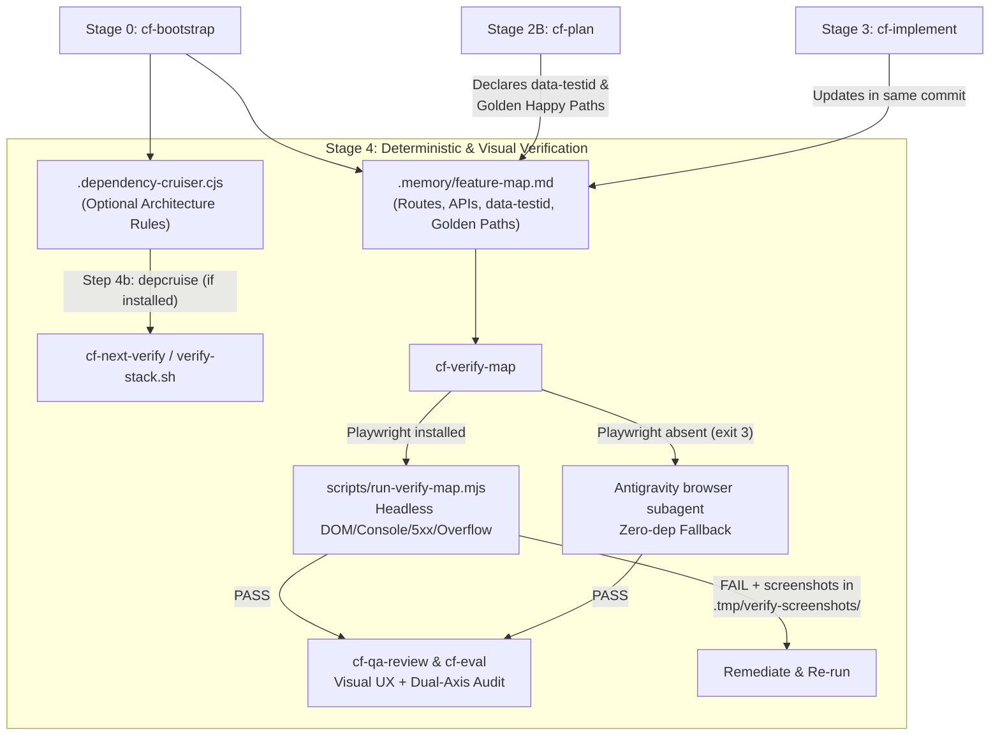
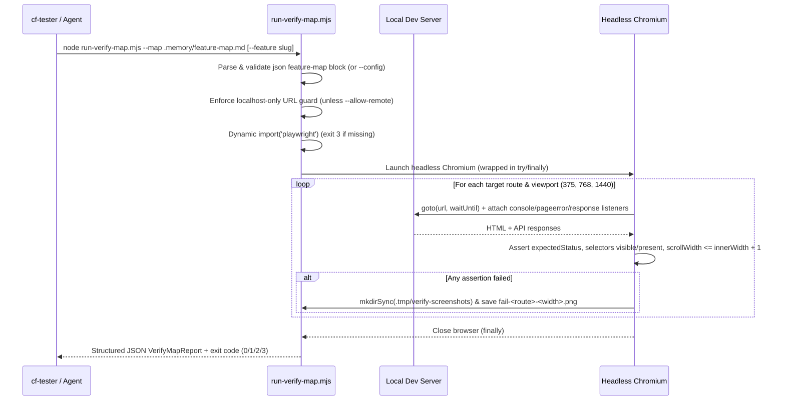

# Feature Spec: Feature Map Verification & Architectural Boundary Gates (`code-factory` v2.4.0)

**Status:** Locked (Approved — Scope C: Plugin v2.4.0 + Academy Dogfooding + `dependency-cruiser` + `playwright`)  
**Date:** 2026-11-25  
**Research / Evaluation Input:** `project-antigravity-verification-kit.zip` evaluation + `.memory/architecture.md` + `.memory/research-vibe-coding-lit-factory.md`  
**Related ADR:** `.memory/decisions/0004-feature-map-and-architecture-boundary-verification.md`

---

## 1. Overview & Goals

### Problem Statement
Enterprise Code Factory (`v2.3.0`) enforces strong static checks (`tsc`, `eslint`, Vitest, `NEXT_PUBLIC_*`/`service_role` regex scans via `cf-next-verify`) and LLM-driven visual audits (`browser` subagent in `cf-qa-review`). However, two deterministic harness gaps remain:

1. **No Living Feature-to-Runtime Contract:** Shipped routes, API endpoints, stable `data-testid` selectors, and golden happy paths are scattered across historical `plans/*-spec.md` files and component code. Each QA or debugging session wastes tokens rediscovering routes and selectors—or misses regressions in unchanged features.
2. **No Automated Module-Graph Boundary Gate:** Architectural layering rules (no circular imports, no server/DB modules imported by UI components, no `src/lib/` importing `src/app/` or UI, optional feature-slice isolation) live only as prose rather than an automated CI/verifier check.
3. **Missing Fast Deterministic Browser Smoke Layer:** Jumping directly from jsdom unit tests to LLM-driven browser inspection burns tokens on basic route/console/5xx/selector smoke checks that a headless Playwright script can verify deterministically in seconds.

### Goals
- Ship a **zero-dependency plugin upgrade (`code-factory` v2.4.0)** introducing `skills/cf-verify-map/` with dual-mode execution:
  - **Fast Deterministic Mode:** Headless Playwright runner (`scripts/run-verify-map.mjs`) parsing `.memory/feature-map.md` directly (or `--config <file.json>`) with multi-viewport overflow checks, console/pageerror/network assertions, and preserved failure screenshots.
  - **Zero-Dependency Fallback Mode:** Graceful delegation to Antigravity's built-in `browser` subagent when Playwright is not installed in the target workspace.
- Scaffold `.memory/feature-map.md` (credential-free) and optional `.dependency-cruiser.cjs` via `cf-bootstrap`.
- Auto-run `depcruise` in `skills/cf-next-verify/scripts/verify-stack.sh` whenever a target repository configures `.dependency-cruiser.*` and installs `dependency-cruiser`.
- Wire lightweight touchpoints across `cf-plan`, `cf-qa-review`, `cf-eval`, `cf-tester`, `rules/AGENTS.md` (staying strictly `<= 10 KB`), `plugin.json`, and `README.md`.
- *(Optional Layer 2)* Dogfood `.memory/feature-map.md` and `academy/.dependency-cruiser.cjs` on `academy/` and sync `academy/scripts/sync-resources.ts`.

### Explicit Non-Goals
- **No forced global/plugin `node_modules`:** The `code-factory` plugin itself must remain strictly zero-dependency (Node.js built-ins, Python 3 stdlib, POSIX Bash).
- **No replacement of Antigravity's `browser` subagent:** `cf-verify-map` handles deterministic smoke/contract verification; visual aesthetics, WCAG color contrast, keyboard focus rings, and exploratory UX remain with the `browser` subagent in Stage 4 (`cf-qa-review`).
- **No plaintext credentials in `.memory/`:** Test credentials in `.memory/feature-map.md` must reference environment variables or seed scripts, never hardcoded passwords.
- **No automatic `npm install` or Chromium download:** Installing `dependency-cruiser` or `playwright` in any project remains strictly **Human-Lit** (requires explicit engineer approval).

---

## 2. System Architecture



### Execution Sequence (Fast Deterministic Mode)



---

## 3. Contracts, Schemas & CLI Interface

### 3.1 Canonical `.memory/feature-map.md` Contract
To prevent LLM Markdown-to-JSON transcription errors, `.memory/feature-map.md` contains:
1. **Human-Readable Runtime & Feature Index** (for engineers and `browser` subagent multi-step Golden Happy Paths).
2. **Deterministic Machine Contract Block** inside a fenced ```` ```json feature-map ```` code block parsed directly by `run-verify-map.mjs`.

```json
{
  "baseUrl": "http://localhost:3000",
  "healthCheck": "/api/health",
  "viewports": [
    { "name": "mobile", "width": 375, "height": 812 },
    { "name": "tablet", "width": 768, "height": 1024 },
    { "name": "desktop", "width": 1440, "height": 900 }
  ],
  "ignoreUrls": [
    "/favicon.ico"
  ],
  "targets": [
    {
      "feature": "home-dashboard",
      "route": "/",
      "expectedStatus": 200,
      "waitUntil": "domcontentloaded",
      "waitForSelector": "[data-testid='app-shell']",
      "selectors": [
        "[data-testid='app-shell']",
        "[data-testid='primary-nav']"
      ],
      "checkOverflow": true,
      "timeoutMs": 15000
    }
  ]
}
```

#### Runtime Validation Schema Rules (enforced inside `run-verify-map.mjs` without external deps)
| Field | Type | Constraints / Default |
|---|---|---|
| `baseUrl` | `string` | Required valid `http:` or `https:` URL. Host must be `localhost`, `127.0.0.1`, or `::1` unless `--allow-remote` CLI flag is explicitly passed. |
| `healthCheck` | `string` | Optional path (e.g. `"/api/health"`). Must start with `"/"`. |
| `viewports` | `Viewport[]` | Optional; defaults to `[{ name: "desktop", width: 1440, height: 900 }]` or `[375, 768, 1440]` when `--all-viewports` is passed. Each `width` in `[320..3840]`, `height` in `[320..2160]`. |
| `ignoreUrls` | `string[]` | Optional list of URL substrings/paths ignored by network `>= 400` checks (defaults to `["/favicon.ico"]`). |
| `targets` | `Target[]` | Required non-empty array (`length >= 1`). |
| `targets[].feature` | `string` | Required non-empty slug (`^[a-z0-9][a-z0-9-_]*$`). |
| `targets[].route` | `string` | Required string starting with `"/"`. |
| `targets[].expectedStatus` | `number` | Optional integer `100..599` (default `200`). Allows intentional `401`/`404` route assertions without false failure. |
| `targets[].waitUntil` | `enum` | Optional `"domcontentloaded" \| "load" \| "networkidle"` (default `"domcontentloaded"` — avoids Next.js HMR/SSE hangs). |
| `targets[].waitForSelector` | `string` | Optional CSS selector waited on before running selector/overflow assertions. |
| `targets[].selectors` | `string[]` | Optional array of CSS/`data-testid` selectors that must match `count >= 1`. |
| `targets[].checkOverflow` | `boolean` | Optional (default `true`): asserts `document.documentElement.scrollWidth <= window.innerWidth + 1`. |
| `targets[].timeoutMs` | `number` | Optional integer `1000..60000` (default `15000`). |

### 3.2 CLI Contract (`skills/cf-verify-map/scripts/run-verify-map.mjs`)

```bash
# Primary mode: parse ```json feature-map``` block directly from .memory/feature-map.md
node "<skill-dir>/scripts/run-verify-map.mjs" \
  --map .memory/feature-map.md \
  [--feature <slug>] \
  [--all-viewports] \
  [--base-url http://localhost:3000] \
  [--screenshot-dir .tmp/verify-screenshots] \
  [--allow-remote]

# Compatibility mode: load standalone JSON config file
node "<skill-dir>/scripts/run-verify-map.mjs" --config .tmp/verify-targets.json
```

#### Deterministic Exit Codes
| Code | Constant | Meaning |
|---|---|---|
| `0` | `PASS` | Every selected target and viewport passed all checks. |
| `1` | `VERIFICATION_FAIL` | One or more routes failed (status mismatch, console error, pageerror, unexpected `4xx`/`5xx`, missing selector, overflow, or timeout). Screenshots saved to `--screenshot-dir`. |
| `2` | `CONFIG_ERROR` | Missing file, malformed JSON/Markdown block, schema validation failure, unknown `--feature`, or blocked remote URL without `--allow-remote`. |
| `3` | `PLAYWRIGHT_UNAVAILABLE` | `playwright` package or Chromium browser binary is not installed; signals `cf-verify-map` skill to cleanly fall back to Antigravity's `browser` subagent. |

#### Stdout JSON Report Contract (`VerifyMapReport`)
```json
{
  "schemaVersion": "1.0",
  "status": "PASS | FAIL | CONFIG_ERROR | PLAYWRIGHT_UNAVAILABLE",
  "baseUrl": "http://localhost:3000",
  "scope": "all | <feature-slug>",
  "summary": {
    "totalChecks": 3,
    "passed": 3,
    "failed": 0
  },
  "results": [
    {
      "feature": "home-dashboard",
      "route": "/",
      "viewport": "desktop (1440x900)",
      "status": "PASS | FAIL",
      "httpStatus": 200,
      "consoleErrors": [],
      "pageErrors": [],
      "networkErrors": [],
      "missingSelectors": [],
      "horizontalOverflowPx": 0,
      "screenshotPath": null
    }
  ]
}
```

### 3.3 Generalized `.dependency-cruiser.cjs` Template Contract
Located at `skills/cf-verify-map/resources/dependency-cruiser.template.cjs`:
1. **`no-circular` (error):** Zero circular dependencies across `src/`.
2. **`no-server-or-db-in-ui` (error):** Modules under `src/(components|features/.*/components)/` cannot import `src/(db|server)/`, `server-only`, `supabase.*admin`, `prisma`, `drizzle`, `firebase-admin`, or Node built-ins (`node:fs`, `node:child_process`, `fs`, `child_process`).
3. **`no-lib-importing-app-or-ui` (error):** Pure domain/utility modules under `src/lib/` cannot import `src/app/` or `src/components/` (enforces unidirectional dependency flow).
4. **`no-cross-feature-imports` (error, active when `src/features/` exists):** Modules under `src/features/<A>/` cannot import `src/features/<B>/`; shared contracts must live in `src/shared/` or `src/lib/`.

### 3.4 `verify-stack.sh` Step 4b Contract
In `skills/cf-next-verify/scripts/verify-stack.sh` (between Step 4 Static Boundary Scan and Step 5 Build):
- Detect config file in priority order: `.dependency-cruiser.cjs`, `.dependency-cruiser.js`, `.dependency-cruiser.mjs`.
- If config exists AND `src/` exists AND `$PM_EXEC depcruise --version` succeeds:
  - Run `run_step "Architecture Boundaries" "$PM_EXEC depcruise src --config $DEPCRUISE_CFG"`.
- If config exists but `depcruise` is not installed:
  - `record_step "Architecture Boundaries" "SKIP" "$DEPCRUISE_CFG found, install dependency-cruiser to enable"`.
- If no config exists:
  - `record_step "Architecture Boundaries" "SKIP" "no .dependency-cruiser.* config"`.

---

## 4. File, State & Plugin Manifest Changes

### Layer 1 — Global `code-factory` Plugin (`v2.3.0` → `v2.4.0`, Zero New Dependencies)
- **New Skill Directory (`skills/cf-verify-map/`):**
  - `skills/cf-verify-map/SKILL.md` — Dual-mode protocol (Playwright deterministic runner + `browser` subagent fallback; explicit `.tmp/verify-screenshots/` retention on failure; never claims PASS on errors).
  - `skills/cf-verify-map/scripts/run-verify-map.mjs` — Hardened ESM verifier with exported pure helpers (`extractFeatureMapJson`, `validateConfig`, `isLocalhostUrl`, `isIgnoredUrl`) so unit tests run cleanly without launching Chromium.
  - `skills/cf-verify-map/scripts/test_run_verify_map.mjs` — Deterministic Node built-in `node:test` suite verifying parser, validator, security guards, CLI error exit codes (`2` & `3`), and screenshot path containment.
  - `skills/cf-verify-map/resources/feature-map-template.md` — Credential-free `.memory/feature-map.md` template.
  - `skills/cf-verify-map/resources/dependency-cruiser.template.cjs` — Generalized architectural boundary template.
- **Modified Plugin Files:**
  - `skills/cf-bootstrap/scripts/bootstrap.sh` — Non-destructively copy `.memory/feature-map.md` (always) and `.dependency-cruiser.cjs` (only if `package.json` exists in target dir); print `.tmp/` `.gitignore` reminder.
  - `skills/cf-bootstrap/SKILL.md` — Document new scaffolded files.
  - `skills/cf-next-verify/scripts/verify-stack.sh` & `SKILL.md` — Add Step 4b optional `depcruise` gate.
  - `skills/cf-plan/SKILL.md` — Add `data-testid` contract + Golden Happy Path requirement under UI/UX specs.
  - `skills/cf-qa-review/SKILL.md` — Add `cf-verify-map` pre-flight check + Feature Map sync check before visual UX audit.
  - `skills/cf-eval/SKILL.md` — Add `depcruise` boundary check and Feature Map sync to Output & Trajectory axes.
  - `agents/cf-tester.md` — Add `skills/cf-verify-map` to `skills:` frontmatter.
  - `rules/AGENTS.md` — Add concise references in Section 2 (`.memory/feature-map.md`) and Section 6 (`cf-verify-map` + Feature Map sync on UI/route/API changes). **Context budget:** `8,494 B` → `~8,850 B` (strictly `<= 10,240 B` per Rule 8.4).
  - `plugin.json` — Bump version `"2.3.0"` → `"2.4.0"`, update description to 15 skills.
  - `README.md` — Sync stale `v2.2.0` / 12-skill description to `v2.4.0` / 15 skills + add `node --test skills/cf-verify-map/scripts/test_run_verify_map.mjs` to test commands.

### Layer 2 — Optional `academy/` Dogfooding & Resource Sync
- `.memory/feature-map.md` — Populated contract for `academy/` covering `/`, `/api/courses`, `/api/resources`, `/api/hitl/simulate`, and core interactive selectors.
- `academy/.dependency-cruiser.cjs` — App Router rules tailored to `academy/src/` (`no-circular`, `no-server-or-db-in-ui`, `no-lib-importing-app-or-ui`).
- `academy/scripts/sync-resources.ts` — Add `"cf-verify-map": "Stage 4: Feature Map Verification"` to `SKILL_STAGE_MAP` and `"feature-map.md": "Living Feature Contract"` to `memoryStageMap`, then run `pnpm run sync:resources`.
- `.gitignore` — Add `.tmp/`.
- *(Human-Lit Dependency Decision)* Optionally install `dependency-cruiser` (MIT, `^16.x`/`^17.x`) in `academy/package.json` `devDependencies` (and optionally `playwright` Apache-2.0 if headless Chromium CI is desired for `academy/`).

---

## 5. UI/UX, Accessibility & Multi-Viewport Verification Specs

- **Deterministic Smoke Scope (`cf-verify-map`):**
  - Verifies DOM presence of declared `data-testid` contracts (`count >= 1`).
  - Captures every `console.error`, uncaught `pageerror`, HTTP status mismatch, and unexpected `>= 400` network failure.
  - Measures horizontal overflow (`document.documentElement.scrollWidth - window.innerWidth`) at **Mobile (`375×812`)**, **Tablet (`768×1024`)**, and **Desktop (`1440×900`)** when `--all-viewports` is active (or viewports are specified in the map).
  - Preserves failure screenshots at `.tmp/verify-screenshots/fail-<safe-route>-<viewport>.png` so engineers/reviewers can inspect them; temporary flow scripts in `.tmp/flows/` are cleaned up separately without deleting screenshots.
- **Visual & WCAG 2.1 AA Scope (Antigravity `browser` subagent in `cf-qa-review`):**
  - Continues to own visual design-token compliance, 4.5:1 / 3:1 contrast verification, `:focus-visible` keyboard navigation, Loading/Error/Empty UX states, and multi-step interactive flows when Playwright is absent or full visual QA is required.

---

## 6. Selective Autonomy, Security & Testing Checklist

### Selective Autonomy Matrix
| Work Item | Classification | Rationale & Oracle |
|---|---|---|
| `run-verify-map.mjs` + `test_run_verify_map.mjs` | **Lights-Out** | Pure Node.js ESM with deterministic `node --test` oracle covering all branches. |
| `cf-bootstrap` & `verify-stack.sh` updates | **Lights-Out** | Deterministic bash execution tested against temp fixture dirs + `academy/`. |
| `SKILL.md` updates, `README.md`, `plugin.json` | **Lights-Out** | Verified via `sync:resources`, `vitest`, and `wc -c rules/AGENTS.md <= 10240`. |
| `rules/AGENTS.md` global invariant edit | **Human-Lit** | Always-on global rule file affecting all projects; requires explicit spec approval. |
| Installing `dependency-cruiser` / `playwright` in `academy/` | **Human-Lit** | Third-party dependency addition (Security Invariant #4); license + CVE check (`pnpm audit --audit-level=high`) and explicit user approval required. |

### Security Invariants
- **Zero Hardcoded Secrets:** `feature-map-template.md` forbids plaintext passwords (references `$TEST_USER_EMAIL` / `$TEST_USER_PASSWORD` or seed scripts); verified against `hooks/secret-guard.py`.
- **SSRF / Scope Guard:** `run-verify-map.mjs` rejects non-localhost `baseUrl` hosts (`exit 2`) unless `--allow-remote` is explicitly passed.
- **Path Traversal Prevention:** Screenshot output paths are sanitized (`[^a-z0-9_-]` → `_`) and resolved strictly within `--screenshot-dir`.
- **Resource Hygiene:** Browser launch wrapped in `try / finally` to guarantee Chromium termination on error or timeout.

### Verification Oracles (Required Green Before Stage 4 Sign-Off)
1. `node --test skills/cf-verify-map/scripts/test_run_verify_map.mjs` — 100% pass (happy path, invalid JSON, malformed schema, non-localhost rejection, `ignoreUrls` filtering, missing Playwright exit code `3`, path sanitization).
2. `python3 -m unittest -v hooks/test_hitl_gate.py hooks/test_secret_guard.py` — 12/12 pass.
3. `wc -c rules/AGENTS.md` — strictly `<= 10240` bytes.
4. `bash skills/cf-bootstrap/scripts/bootstrap.sh "$(mktemp -d)"` — non-destructive creation + second run skips 100% of existing files.
5. `bash skills/cf-next-verify/scripts/verify-stack.sh academy --skip-build` — all checks green (including Step 4b `Architecture Boundaries` `PASS` if `dependency-cruiser` is installed in `academy/`, or clean `SKIP` otherwise).
6. If Layer 2 is included: `cd academy && pnpm run sync:resources && pnpm run test` — all Vitest tests pass with `cf-verify-map` and `feature-map.md` indexed cleanly.

---

## 7. Atomic Task Breakdown (Non-Overlapping File Partitions)

- [x] **Task 0 (Contracts, Templates & Skill Protocol — Prerequisite):**
  - Create `skills/cf-verify-map/resources/feature-map-template.md`
  - Create `skills/cf-verify-map/resources/dependency-cruiser.template.cjs`
  - Create `skills/cf-verify-map/SKILL.md`
- [x] **Task 1 (Hardened Playwright Verifier & Unit Tests — `cf-tester`):**
  - Create `skills/cf-verify-map/scripts/run-verify-map.mjs`
  - Create `skills/cf-verify-map/scripts/test_run_verify_map.mjs`
  - Run `node --test skills/cf-verify-map/scripts/test_run_verify_map.mjs`
- [x] **Task 2 (Bootstrap & Stack Verifier Integration — `cf-backend`):**
  - Update `skills/cf-bootstrap/scripts/bootstrap.sh` & `skills/cf-bootstrap/SKILL.md`
  - Update `skills/cf-next-verify/scripts/verify-stack.sh` & `skills/cf-next-verify/SKILL.md`
- [x] **Task 3 (SDLC Skills, Persona, Global Rules & Manifest Sync):**
  - Update `skills/cf-plan/SKILL.md`, `skills/cf-qa-review/SKILL.md`, `skills/cf-eval/SKILL.md`
  - Update `agents/cf-tester.md`
  - Update `rules/AGENTS.md` (verify `<= 10,240` bytes)
  - Update `plugin.json` (`2.4.0`) & `README.md`
- [x] **Task 4 *(Optional Layer 2 — `academy/` Dogfooding)*:**
  - Create `.memory/feature-map.md` & `academy/.dependency-cruiser.cjs`
  - Update `.gitignore` (`.tmp/`) & `academy/scripts/sync-resources.ts`
  - *(With explicit HITL approval)* Install `dependency-cruiser` (and optionally `playwright`) in `academy/package.json` + add `arch:check` script, then run `pnpm audit --audit-level=high` and full verification.
- [x] **Task 5 (Independent Dual-Axis Review — `cf-reviewer` + `cf-eval`):**
  - Run decoupled diff audit, verify all 6 oracles above, and record verdict in `.memory/qa-report.md`.

---

## 8. Senior Engineer Sign-Off

Approved and locked by Senior Engineer on 2026-11-25:
- [x] Spec is self-contained with zero implicit assumptions.
- [x] Contracts (`feature-map.md` schema, CLI exit codes `0/1/2/3`, `.dependency-cruiser.cjs` rules, `verify-stack.sh` Step 4b) are approved.
- [x] Task breakdown is cleanly partitioned into atomic, non-overlapping steps.
- [x] **Scope Confirmed: Scope C** (Plugin `v2.4.0` + `academy/` dogfooding + HITL-approved `dependency-cruiser` [MIT] & `playwright` [Apache-2.0] + Chromium in `academy/`).
