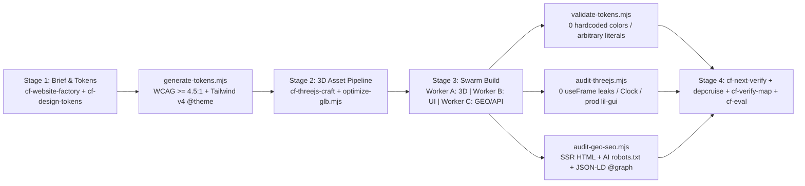

# Feature Spec: Enterprise Code Factory v2.5.0 — Vibe Website Factory Pipeline

**Status:** Locked (User Approved — Phase 1 & 2)  
**Date:** 2026-11-25  
**Research Input:** `.memory/research-vibe-website-factory.md`  
**Related ADR:** `.memory/decisions/0005-vibe-website-factory-pipeline.md`

---

## 1. Overview & Goals

### Problem Statement
Building cutting-edge, visually distinctive, 3D-enhanced, AI-search-citable websites inside Antigravity requires combining four distinct engineering disciplines—Vibe Design & Token-First Systems, Three.js / React Three Fiber 3D performance engineering, Tri-Layer SEO/AEO/GEO discoverability, and multi-agent Code Factory governance—without bloating always-on `AGENTS.md` context (`≤ 10 KB`) or introducing unvetted third-party skill supply-chain risk.

### Goals
1. **Four Progressive-Disclosure `code-factory` Skills (`v2.5.0`):**
   - `skills/cf-website-factory/` — 6-Stage Vibe-to-Ship Website Factory orchestrator + Creative Brief & Proof Pack templates.
   - `skills/cf-design-tokens/` — W3C 3-layer Token-First pipeline (`generate-tokens.mjs`, `validate-tokens.mjs`, starter template, WCAG 2.1 AA contrast enforcement, Tailwind CSS v4 `@theme` output, Vibe Design & UX reference).
   - `skills/cf-threejs-craft/` — Complete distilled Utsubo 100 Three.js Tips reference (WebGPU/TSL, `Timer`, `lil-gui`, `stats-gl`, `Inspector`, R3F rules, Meshopt/Draco/quantization/WebP/KTX2, disposal, mobile fallbacks) + `audit-threejs.mjs` static gate + `optimize-glb.mjs` zero-native-binary `@gltf-transform/cli` wrapper.
   - `skills/cf-geo-seo/` — 7 AI Search Ranking Factors, SEO/AEO/GEO Tri-Layer playbook, connected JSON-LD `@graph` templates, and `audit-geo-seo.mjs` static/rendered HTML & `robots.txt` auditor.
2. **Zero Plugin Runtime Dependencies & Hardened Security:**
   - Pure Node.js ESM (`>= 20`) stdlib scripts only.
   - Zero outbound network calls, zero `eval`/`new Function`, zero shell string concatenation (`execFileSync` arg arrays only where invoking project-local `gltf-transform`).
   - Strict cycle/missing-reference detection and CSS-injection sanitization in `generate-tokens.mjs`.
3. **Deterministic Unit Tests (`node:test`) & Decoupled Verification:**
   - Dedicated `node:test` suites (`tokens.test.mjs`, `threejs.test.mjs`, `geo-seo.test.mjs`) testing happy paths, security boundaries, and failure cases.
   - Live multi-project dry-run against `academy/` + independent `cf-reviewer` security & scalability sign-off (`SHIP`) before building `gt-alpaca-website`.

### Explicit Non-Goals
- Never installing unvetted third-party skill repos wholesale into `code-factory`.
- Never requiring native `KTX-Software` binaries as a mandatory prerequisite (default GLB pipeline uses zero-native-binary Meshopt + `KHR_mesh_quantization` + WebP via `@gltf-transform/cli`; KTX2 is documented as optional).
- Never modifying staged v2.4.0 `academy/` curriculum files in this spec.

---

## 2. Architecture & Skill Contracts

### Script Contracts & Exit Codes
All verification scripts follow the unified Code Factory exit-code convention:
- `0` — `PASS` (zero blocking errors)
- `1` — `FAIL` (one or more invariant violations reported with file/line/remediation)
- `2` — `CONFIG_ERROR` (missing required flag, invalid file path, malformed JSON)
- `3` — `TOOL_UNAVAILABLE` (used by `optimize-glb.mjs` if `@gltf-transform/cli` is not installed locally)

#### 1. `skills/cf-design-tokens/scripts/generate-tokens.mjs`
- **Inputs:** `--config <tokens.json> [--out <tokens.css>] [--format css|tailwind-v4] [--skip-contrast]`
- **Validations:**
  - Parses W3C Design Token JSON (`primitive`, `semantic`, `component`, optional `dark.semantic`).
  - Cycle detection (`Set` visited chain) and strict missing-reference errors (never emits `{unresolved}` literals).
  - CSS value sanitization: rejects values containing `;`, `{`, `}`, `</style`, `javascript:`, or `expression(`.
  - Automated **WCAG 2.1 AA Contrast Gate (`≥ 4.5:1`)** on light & dark semantic pairs (`foreground` vs `background`, `primary-foreground` vs `primary`, `secondary-foreground` vs `secondary`, `destructive-foreground` vs `destructive`, `muted-foreground` vs `background`) when both resolve to hex colors.
- **Outputs:** Clean `:root` + `.dark` CSS custom properties, plus optional Tailwind CSS v4 `@theme inline { ... }` block mapping semantic colors, radii, fonts, and spacing.

#### 2. `skills/cf-design-tokens/scripts/validate-tokens.mjs`
- **Inputs:** `--dir <srcDir> [--ignore <dir>] [--json]`
- **Checks (fixing false positives/blind spots from `ui-ux-pro-max-skill`):**
  - Detects Tailwind arbitrary color/spacing brackets: `bg-[#...]`, `text-[#...]`, `border-[#...]`, `p-[17px]`, `text-[13px]`, `gap-[19px]`, etc.
  - Detects raw CSS hex/rgb/rgba/hsl color declarations inside CSS/TSX inline style objects while ignoring HTML `#anchor` hrefs (`href="#..."`), JS comments, Three.js `0x` scene-palette data files marked `// @tokens-ignore-file` (or dedicated `data/` color registries), `tokens.css`, `tokens.json`, and `globals.css` token definitions.

#### 3. `skills/cf-threejs-craft/scripts/audit-threejs.mjs`
- **Inputs:** `--dir <srcDir> [--json]`
- **Static Rules (only scans files importing `three` or `@react-three/fiber` / `@react-three/drei`):**
  - `ERROR` **No `setState` inside `useFrame`** (prevents 60–120fps React re-render storms).
  - `ERROR` **No `new THREE.*` object allocation inside `useFrame`** (prevents GC frame hitches).
  - `ERROR` **No deprecated `THREE.Clock`** (require `Timer` from `three` since r183).
  - `ERROR` **No unguarded `lil-gui` or `stats-gl` import** without `NODE_ENV === "development"` / dynamic dev guard.
  - `ERROR` **No uncapped `setPixelRatio(window.devicePixelRatio)`** without `Math.min(..., 2)`.
  - `WARN` Missing `.dispose()` cleanup in raw `THREE.WebGLRenderer` / `BufferGeometry` / `Material` files.
  - `WARN` Missing `prefers-reduced-motion` or `webglcontextlost` fallback check in `<Canvas>` / renderer mount files.

#### 4. `skills/cf-threejs-craft/scripts/optimize-glb.mjs`
- **Inputs:** `--in <input.glb> --out <output.glb> [--texture-format webp|ktx2] [--max-texture-size 1024] [--dry-run]`
- **Security:** Strictly validates `.glb` extension, rejects control characters/null bytes, resolves canonical paths, and invokes project-local `gltf-transform` via `execFileSync` with an argument array (zero shell interpolation!).
- **Pipeline:** `prune` → `weld` → `quantize` (`KHR_mesh_quantization`) → `meshopt` → `webp` (default, zero native binary!) or `ktx2` (optional when `ktx` installed), printing structured JSON/summary with `inputBytes`, `outputBytes`, and `reductionPercent`.

#### 5. `skills/cf-geo-seo/scripts/audit-geo-seo.mjs`
- **Inputs:** `--html <fileOrDir> [--robots <robots.txt>] [--json]`
- **Checks:**
  - **SSR Crawlability:** Verifies `<html lang="...">`, non-empty `<h1>`, and `≥ 120` words of visible semantic text outside `<script>`/`<style>`/`<canvas>` (catches "WebGL Black Box" / blank CSR shells).
  - **Metadata Bounds:** `<title>` present & `≤ 60` chars (warning if `> 60`, error if missing); `<meta name="description">` present & `120–160` chars (warning outside `140–155`, error if missing); canonical `<link rel="canonical">` present.
  - **Connected JSON-LD `@graph`:** Parses all `<script type="application/ld+json">` blocks; fails on invalid JSON; checks `@context`, `@graph` (or typed entities), and verifies internal `@id` cross-references resolve inside the graph; checks `FAQPage` answer word counts (`30–90` words recommended; flags empty or >150 word walls).
  - **AI Crawler `robots.txt` Gate:** When `--robots` is provided, fails if `Google-Extended`, `GPTBot`, `ClaudeBot`, or `PerplexityBot` is blocked with `Disallow: /` (unless explicitly opted out via `--allow-ai-block`).

---

## 3. Verification & Acceptance Criteria
1. All new `node:test` suites (`tokens.test.mjs`, `threejs.test.mjs`, `geo-seo.test.mjs`) pass `100%`.
2. Existing regression suites pass `100%` (`12/12` Python hooks, `15/15` `cf-verify-map` tests).
3. `rules/AGENTS.md` remains `≤ 10,240` bytes (`≤ 10 KB`).
4. `plugin.json` updated cleanly to `2.5.0` (19 skills) and `README.md` reflects the 4 new Website Factory skills.
5. Dry-run of `audit-threejs.mjs` and `validate-tokens.mjs` on `academy/src` executes cleanly with zero crashes.
6. Independent `cf-reviewer` subagent audits all new skills & scripts and returns an explicit **`SHIP`** verdict.
