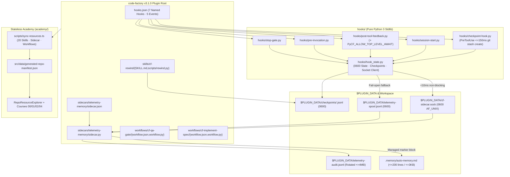
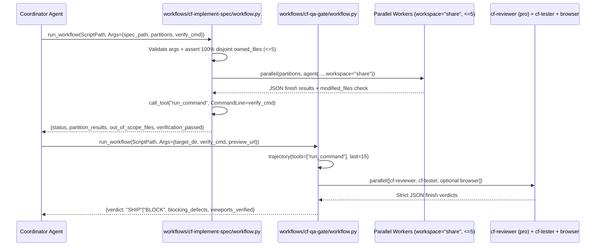

# Feature Spec: Enterprise Code Factory v3.1.0 — Phase 2: Git-Shadow Checkpoints (`cf-rewind`), `0600` Async Telemetry/Memory Sidecar & Bundled `run_workflow` SDLC Pipelines

**Status:** Locked — Approved for Stage 3 Execution  
**Date:** 2026-11-26  
**Research Input:** [`.memory/research.md`](file:///Users/ralphb/Projects_Personal/Project_Antigravity/.memory/research.md) (§3.4, §5, §6 Phases 2–3)  
**Prior Phase Spec & ADR:** [`plans/code-factory-v3-phase1-spec.md`](file:///Users/ralphb/Projects_Personal/Project_Antigravity/plans/code-factory-v3-phase1-spec.md), [`0006-code-factory-v3-phase1-hook-bridge.md`](file:///Users/ralphb/Projects_Personal/Project_Antigravity/.memory/decisions/0006-code-factory-v3-phase1-hook-bridge.md)  
**Related ADR:** [`0008-git-shadow-checkpoints-sidecar-and-workflows.md`](file:///Users/ralphb/Projects_Personal/Project_Antigravity/.memory/decisions/0008-git-shadow-checkpoints-sidecar-and-workflows.md)  
**Primary Platform Contracts Verified:**  
- [`agy-customizations/docs/plugins.md`](file:///Users/ralphb/.gemini/antigravity/builtin/skills/agy-customizations/docs/plugins.md)  
- [`agy-customizations/docs/json_configs.md`](file:///Users/ralphb/.gemini/antigravity/builtin/skills/agy-customizations/docs/json_configs.md)  
- [`agy-customizations/docs/hooks.md`](file:///Users/ralphb/.gemini/antigravity/builtin/skills/agy-customizations/docs/hooks.md)  
- [`run-workflow/SKILL.md`](file:///Users/ralphb/.gemini/antigravity/builtin/skills/run-workflow/SKILL.md)  
- [`antigravity_guide/SKILL.md`](file:///Users/ralphb/.gemini/antigravity/builtin/skills/antigravity_guide/SKILL.md) + live `https://antigravity.google/docs/sidecars.md`

---

## 1. Overview, Goals & Explicit Non-Goals

### Problem Statement
`code-factory` `v3.0.1` ships a deterministic 5-event Phase 1 lifecycle hooks layer (`hooks/hook_state.py`, `session-start.py`, `hitl-gate.py`, `secret-guard.py`, `post-tool-feedback.py`, `pre-invocation.py`, `stop-gate.py`) and 19 progressive skills, leaving three Phase 2/3 harness capabilities outlined in [`.memory/research.md`](file:///Users/ralphb/Projects_Personal/Project_Antigravity/.memory/research.md) unimplemented:
1. **Shell-Inclusive Pre-Turn Rollback Gap:** Antigravity's built-in `/rewind` does not reliably snapshot arbitrary shell mutations (`run_command`) alongside file edits, and offers no structured checkpoint audit trail or safe dry-run diff/restore CLI.
2. **Synchronous Hook Telemetry & Auto-Memory Gap:** Antigravity hooks run synchronously (`command` only). Blocking on HTTP/webhook logging inside hooks degrades turn latency, and cross-session lessons still require manual `cf-learn` / `cf-handover` runs rather than bounded background distillation into `.memory/auto-memory.md`.
3. **Prose-Only Multi-Agent Orchestration:** `cf-implement` and `cf-qa-review` still rely on prompt instructions rather than reusable, schema-validated `run_workflow` Python pipelines (`cf-implement-spec` with disjoint `workspace="share"` partitions and `cf-qa-gate` with parallel decoupled `cf-reviewer` + `cf-tester` + optional `browser`).
4. **Course 01 & Academy Drift:** `academy/content/courses/harness-mastery/course.json` Step 5 still shows a non-executable conceptual snippet (`from antigravity_workflow import agent, parallel, finish`), and `academy/` needs lockstep `3.1.0` sync (`20` skills including `cf-rewind`, `sidecar` + `workflow` resources, and `20/20` filesystem-backed Skill Traceability).

### Goals
1. **Track A — Git-Shadow Checkpoints + `cf-rewind` (`v3.1.0`):**
   - Implement `hooks/checkpoint-hook.py` (`PreToolUse` on `write_file|edit_file|write_to_file|replace_file_content|multi_replace_file_content|run_command`) using per-turn deduplicated, non-destructive `git stash create` (with clean-`HEAD` baseline fallback and unborn-`HEAD` handling), bounded strictly to `<= 150 ms` via `.git/index`/pack size guards and `120 ms` subprocess timeout budgets.
   - Persist checkpoint metadata via `hooks/hook_state.py` to `0600`-permissioned `$PLUGIN_DATA/checkpoints/<safe_cid>.jsonl`.
   - Ship `skills/cf-rewind/SKILL.md` + `skills/cf-rewind/scripts/rewind.py` (pure Python 3 stdlib) supporting `list`, `diff`, `restore` (`--dry-run` default; `--apply` takes a mandatory pre-restore safety snapshot before restoring tracked files without `git reset --hard`), and `prune`.
2. **Track B — Async Telemetry & Auto-Memory Sidecar (`sidecars/telemetry-memory/`):**
   - Ship `sidecars/telemetry-memory/sidecar.json` conforming strictly to Antigravity's `sidecars.md` schema (`display_name`, `description`, `command`, `args`, `restart_policy`, `env`) alongside `sidecars/telemetry-memory/sidecar.py` (pure Python 3 stdlib).
   - Listen strictly on a `0600`-permissioned Unix domain socket (`$PLUGIN_DATA/cf-sidecar.sock`, never TCP `0.0.0.0`, with macOS `104`-byte `sun_path` fallback endpoint pointer), validate strict NDJSON schemas, redact secrets/ANSI, rotate bounded JSONL audit logs (`telemetry-audit.jsonl`), optionally forward redacted telemetry to an `https://` webhook when explicitly configured, and distill high-signal verified events into a bounded `<= 200`-line / `<= 3 KB` `.memory/auto-memory.md` managed block without ever overwriting user-authored notes.
   - Add a `< 10 ms` fail-open client emitter (`emit_sidecar_event`) in `hooks/hook_state.py` with bounded local spool fallback (`telemetry-spool.jsonl`) so disabled/absent/crashed sidecars never block or break hooks.
3. **Track C — Bundled Typed `run_workflow` SDLC Pipelines (`workflows/`):**
   - Package two self-contained `run_workflow` pipelines grounded strictly in [`run-workflow/SKILL.md`](file:///Users/ralphb/.gemini/antigravity/builtin/skills/run-workflow/SKILL.md):
     1. `workflows/cf-qa-gate/` (`workflow.json` + `workflow.py`) — Stage 4 parallel decoupled `cf-reviewer` + `cf-tester` + optional `browser` audit producing a strict JSON-schema `SHIP` / `BLOCK` verdict.
     2. `workflows/cf-implement-spec/` (`workflow.json` + `workflow.py`) — Stage 3 parallel `workspace="share"` workers bounded to `<= 5` strictly disjoint file partitions followed by a verification gate.
   - Ship `workflows/validate_workflows.py` (pure stdlib schema + `ast.PyCF_ALLOW_TOP_LEVEL_AWAIT` syntax validator) and wire `workflows/*.py` top-level `await` compile awareness into `hooks/post-tool-feedback.py`.
4. **Track D — Lockstep `plugin.json` (`3.1.0`), `README.md`, `rules/AGENTS.md` & Stateless Academy Sync:**
   - Bump `plugin.json` and `README.md` to `3.1.0`; keep `rules/AGENTS.md <= 10,240` bytes (`<= 10 KB`); keep `academy/` 100% stateless (`localStorage` + Zod) with zero new npm or PyPI dependencies.
   - Extend `academy/src/lib/schemas.ts`, `repository.ts`, `contracts.ts`, `RepoResourceExplorer.tsx`, and `academy/scripts/sync-resources.ts` to ingest `sidecar` and `workflow` resources and map all `20` skills (`cf-rewind` added to `SKILL_STAGE_MAP`).
   - Update Course 00/01/02/04 (`harness-mastery` Step 5 fixed to real `run_workflow` syntax, `code-factory-sdlc` Step 11 + `cf-prompt-rewind`, `lit-software-factory` workflow/sidecar traceability) so the filesystem-backed **`20/20` Skill Traceability** Vitest suite passes.

### Explicit Non-Goals
- **Deferred to Phase 3 (`v3.2.0`):** Companion `code-factory-lsp` MCP plugin (`mcp-language-server` / `ast-grep-mcp`), interactive MCP App Mission Control side pane (`@modelcontextprotocol/sdk` + `@modelcontextprotocol/ext-apps`), and headless `agy -p` budget-capped CI/SARIF runner (`scripts/cf-ci-runner.py`).
- **Zero External Dependencies:** Strictly **zero** new npm packages (`package.json` / `pnpm-lock.yaml` unchanged) and **zero** third-party PyPI packages (`requirements.txt` none; pure Python 3 stdlib only).
- **Zero Auth / DB / State in `academy/`:** No user login, cookies, Postgres tables, or runtime shell execution in Next.js API routes.

---

## 2. System Architecture & Verified Antigravity Platform Contracts

### 2.1 Primary-Source Findings & Platform Caveats (Honest Grounding)

Inspection of Antigravity's local customization docs ([`plugins.md`](file:///Users/ralphb/.gemini/antigravity/builtin/skills/agy-customizations/docs/plugins.md), [`json_configs.md`](file:///Users/ralphb/.gemini/antigravity/builtin/skills/agy-customizations/docs/json_configs.md), [`hooks.md`](file:///Users/ralphb/.gemini/antigravity/builtin/skills/agy-customizations/docs/hooks.md)), [`run-workflow/SKILL.md`](file:///Users/ralphb/.gemini/antigravity/builtin/skills/run-workflow/SKILL.md), and [`antigravity_guide/SKILL.md`](file:///Users/ralphb/.gemini/antigravity/builtin/skills/antigravity_guide/SKILL.md) + `https://antigravity.google/docs/sidecars.md` surfaced **four essential runtime constraints** this design handles explicitly:

1. **Local vs. Live Docs Gap on `sidecars/`:** Local `agy-customizations/docs/plugins.md` documents `plugin.json`, `mcp_config.json`, `hooks.json`, `rules/`, and `skills/` only; `sidecars/` is documented via `antigravity_guide/SKILL.md` → `https://antigravity.google/docs/sidecars.md` (`~/.gemini/config/plugins/<pluginName>/sidecars/<sidecarName>/sidecar.json`, assigned namespaced ID `<pluginName>/<sidecarName>`, launched with `cwd` set to the `sidecar.json` folder).
2. **Sidecar Enablement & Env Divergence (`PLUGIN_DATA` vs. `ANTIGRAVITY_EXECUTABLE_DATA_DIR`):**
   - Antigravity sidecars are disabled by default until enabled in `~/.gemini/config/config.json`, and do not run inside isolated `unittest` or standalone headless `agy -p` invocations without a running supervisor.
   - `hooks.md` provides `PLUGIN_DATA` only to **installed** plugins' hooks/MCP servers (symlinked plugins in `~/.gemini/config/plugins/code-factory` may omit `PLUGIN_DATA`), while `sidecars.md` injects `ANTIGRAVITY_EXECUTABLE_DATA_DIR` (`~/.gemini/antigravity/sidecar_data/<sidecarId>/data/`), NOT guaranteed `PLUGIN_DATA`.
   - POSIX `AF_UNIX` socket paths are capped at **104 bytes** on macOS (`sizeof(sockaddr_un.sun_path)` = 104; Linux = 108). Long `$PLUGIN_DATA` or temp directories exceed 104 bytes.
   - **Design Mitigation:** `hooks/hook_state.py` implements shared `resolve_sidecar_paths()` honoring `$CF_SIDECAR_SOCKET`, `$PLUGIN_DATA/cf-sidecar.sock`, and UID-scoped short-path `.endpoint.json` indirection when `len(utf8(path)) > 100`, plus cross-discovery fallback to `<tempdir>/code-factory-state-<uid>/cf-sidecar.sock` (strictly verified `st_uid == os.getuid()` and `0700`/`0600` non-symlink). Hooks ALWAYS fail open in `< 10 ms` to a bounded local spool (`telemetry-spool.jsonl`), and `sidecar.py` also exposes manual `serve`, `status`, `flush`, `distill`, and `stop` CLI subcommands.
3. **`workflows/` Packaging & `workflow.json` Contract:**
   - Neither local `plugins.md` nor `antigravity.google/docs/plugins.md` auto-registers plugin `workflows/` as slash commands (legacy markdown `.agents/workflows/*.md` are deprecated per `migrate-workflows/SKILL.md`).
   - `run-workflow/SKILL.md` specifies: `run_workflow(ScriptPath="/abs/path/workflow.py", Args={...}, Description="...")`, where `"When ScriptPath is a saved workflow's entry script, Args is validated against the args schema in its workflow.json"`, **`"Local modules are not importable"`**, **`"await works at the top level"`**, and primitives (`agent`, `parallel`, `pipeline`, `phase`, `log`, `trajectory`, `call_tool`, `args`, `WORKSPACES`, `CONVERSATION_ID`, `STEP_INDEX`) are **injected directly as globals** (there is NO `antigravity_workflow` import module and NO script-level `finish()` call—`finish` is the tool called by each spawned `agent(..., schema=...)`).
   - Because `agy-customizations/docs/` does not publish a formal JSON Schema for `workflow.json`, each bundled workflow pairs an explicit `workflow.json` (JSON Schema Draft-07 `args` + `outputSchema`) with a **100% self-contained** `workflow.py` that performs **redundant fail-closed in-script `validate_args(args)`** and is invoked via `ScriptPath` from `cf-qa-review`, `cf-implement`, and `cf-loop-engineer`.
4. **`run_workflow` Non-Interactive Approval Constraint:** `run-workflow/SKILL.md` specifies `"The user cannot be asked anything from a workflow: a call that needs user approval that has not already been granted is denied"` (raising `ToolError` with `.denied = True`). Therefore `cf-qa-gate` and `cf-implement-spec` MUST catch `ToolError` `.denied` cleanly and never run commands matching `hitl-gate.py` `force_ask` patterns inside automated workflows.

### 2.2 Component Architecture



### 2.3 Sequence Diagrams

#### Track A + B: Pre-Turn Git-Shadow Checkpoint & Fail-Open Async Sidecar Flow

```mermaid
sequenceDiagram
    participant Loop as Antigravity Loop
    participant PreT as hitl-gate / secret-guard
    participant Ckpt as checkpoint-hook.py
    participant State as hook_state.py ($PLUGIN_DATA)
    participant PostT as post-tool-feedback.py
    participant Sidecar as sidecar.py (0600 AF_UNIX)
    participant Mem as .memory/auto-memory.md

    Loop->>PreT: PreToolUse (run_command or write/edit)
    PreT-->>Loop: decision: allow / ask / force_ask / deny
    Loop->>Ckpt: PreToolUse (write/edit/run_command)
    Ckpt->>State: Check turnEpoch vs checkpointedTurnEpoch
    alt Not yet snapshotted this turn & repo within size guard
        Ckpt->>Ckpt: git rev-parse HEAD + git stash create (<=120ms)
        Ckpt->>State: Append 0600 record to checkpoints/<cid>.jsonl
    end
    Ckpt-->>Loop: {"decision": "allow"} (always explicit, <=150ms)

    Loop->>PostT: PostToolUse (tool completion)
    PostT->>State: Update state + <10ms emit_sidecar_event()
    alt Sidecar socket reachable
        State->>Sidecar: Redacted NDJSON event over 0600 AF_UNIX
        Sidecar->>Sidecar: Validate schema, rotate telemetry-audit.jsonl
        Sidecar->>Mem: Upsert high-signal lesson (<=200 lines / <=3KB)
    else Sidecar disabled or unreachable
        State->>State: Append bounded telemetry-spool.jsonl (<10ms fail-open)
    end
    PostT-->>Loop: {}
```

#### Track C: Bundled `run_workflow` Stage 3 & Stage 4 Pipelines



---

## 3. Exact Data Schemas, CLI Flags, Socket Protocol & File Contracts

### 3.1 `hooks/hook_state.py` Shared Extensions (`schemaVersion: 1` Backward-Compatible)

Preserve `SCHEMA_VERSION = 1` and all existing Phase 1 fields cleanly, extending `default_state()` / `normalize_state()` with:

```json
{
  "turnEpoch": 0,
  "checkpointedTurnEpoch": -1,
  "lastInitialNumSteps": 0,
  "lastCheckpointSha": "",
  "lastCheckpointId": "",
  "lastCheckpointAt": null
}
```

- **Bounds & Normalization:** `turnEpoch >= 0` (`int`); `checkpointedTurnEpoch >= -1` (`int`); `lastInitialNumSteps >= 0` (`int`); `lastCheckpointSha` matches `^[0-9a-f]{7,40}$` or `""`; `lastCheckpointId <= 64` chars; `lastCheckpointAt` float or `None`.
- **Turn Advancement Rules:**
  - `hooks/pre-invocation.py`: when `payload.get("initialNumSteps")` is a positive `int` differing from `state["lastInitialNumSteps"]`, set `state["lastInitialNumSteps"] = initial_num_steps` and increment `state["turnEpoch"] += 1` if `state["checkpointedTurnEpoch"] == state["turnEpoch"]` (detects a new user turn even if a prior turn skipped `Stop`).
  - `hooks/stop-gate.py`: whenever `evaluate_stop()` returns `{"decision": "allow"}` (i.e., turn ended rather than continuing via `Stop`), increment `state["turnEpoch"] += 1` inside `update_state` if `state["checkpointedTurnEpoch"] == state["turnEpoch"]`.

### 3.2 Track A — Git-Shadow Checkpoint Schema & `cf-rewind` Contracts

#### Checkpoint JSONL Record (`$PLUGIN_DATA/checkpoints/<safe_cid>.jsonl`, `0600`)
Each line is a self-contained JSON object (`MAX_CHECKPOINTS_PER_CONV = 200`, `MAX_CHECKPOINT_FILE_BYTES = 524288`):

```json
{
  "schemaVersion": 1,
  "checkpointId": "chk-00012-e4a9b1",
  "conversationId": "ec33ebf9-0cba-4100-8142-c61503f6c587",
  "kind": "pre-turn",
  "turnEpoch": 2,
  "stepIdx": 19,
  "timestamp": 1764141000.125,
  "projectDir": "/abs/path/to/repo",
  "branch": "main",
  "headSha": "f100de2abc...",
  "snapshotSha": "9c3d4f8abc...",
  "snapshotType": "stash-create",
  "toolName": "edit_file",
  "targetSummary": "academy/src/lib/schemas.ts",
  "untrackedSample": ["new-note.md"],
  "untrackedCount": 1
}
```

- **`kind`:** `"pre-turn"` | `"pre-restore-safety"`
- **`snapshotType`:**
  - `"stash-create"`: `git stash create` produced a dangling commit SHA capturing staged + unstaged tracked changes on top of `headSha`.
  - `"head"`: working tree had zero tracked changes relative to `headSha`, so `snapshotSha == headSha` directly serves as the exact pre-turn restore commit.
  - `"unborn"`: repository was initialized (`git init`) with zero commits yet; `snapshotSha = ""`, logged cleanly without blocking.
  - `"skipped-size-guard"` | `"skipped-timeout"`: logged for audit visibility if repo exceeded size or timeout bounds.
- **Symlink & Security Guards:** `checkpoints/` directory enforced `0o700`; `<safe_cid>.jsonl` enforced `0o600`, symlink-rejected, and path-validated (`target.resolve().parent == checkpoints_dir.resolve()`). `untrackedSample` capped at `25` sanitized relative paths (`<= 200` chars each).

#### `hooks/checkpoint-hook.py` (`PreToolUse`)
- **Matcher in `hooks.json`:** `"write_file|edit_file|write_to_file|replace_file_content|multi_replace_file_content|run_command"`
- **Execution Order:** Placed after `code-factory-hitl-gate` and `code-factory-secret-guard` in `hooks.json`.
- **Fail-Closed vs. Fail-Open Contract:**
  - Empty, non-JSON, or non-dict stdin -> `{"decision": "ask", "reason": "Enterprise Code Factory Checkpoint Hook: unable to parse hook payload."}` (never `{}`).
  - Valid payload -> **ALWAYS** returns `{"decision": "allow"}` (even on non-git workspaces, unborn `HEAD`, size guard skip, or git timeout).
- **Latency & Repo-Size Guards:**
  - `CF_DISABLE_CHECKPOINTS` (`1`/`true`/`off`) -> `< 1 ms` exit `{"decision": "allow"}`.
  - Per-turn deduplication (`turnEpoch == checkpointedTurnEpoch`) -> `< 5 ms` exit `{"decision": "allow"}`.
  - `.git` directory lookup via pure Python parent walk; if absent -> `< 1 ms`.
  - Pure Python `os.stat()` guard BEFORE spawning `git`: skip `git stash create` if `.git/index` > `CF_CHECKPOINT_MAX_INDEX_BYTES` (default `4_194_304` = `4 MiB`) or `.git/objects/pack` total size > `CF_CHECKPOINT_MAX_PACK_MB * 1024 * 1024` (default `512 MiB`).
  - Single remaining deadline (`CF_CHECKPOINT_TIMEOUT_MS`, default `120`, clamped `[30, 140]`): run `git --no-pager rev-parse --verify HEAD` + `git --no-pager rev-parse --abbrev-ref HEAD` + `git --no-pager stash create` (`shell=False`) strictly inside deadline so total hook wall time stays `<= 150 ms`.

#### `skills/cf-rewind/scripts/rewind.py` CLI Contract
Pure Python 3 stdlib, `isDirectExecution` symlink-safe entrypoint, JSON-ready (`--json`):
- `rewind.py list [--conversation-id <cid>] [--cwd <dir>] [--limit 20] [--json]`
  - `limit` clamped `[1, 100]`, default `20`.
- `rewind.py diff [--id <checkpointId> | --sha <sha> | --latest] [--conversation-id <cid>] [--cwd <dir>] [--stat] [--json]`
  - Validates `<sha>` strictly with `^[0-9a-f]{7,40}$`; runs `git --no-pager diff <sha>` (`shell=False`, `timeout=5.0`).
- `rewind.py restore [--id <checkpointId> | --sha <sha> | --latest] [--dry-run | --apply] [--conversation-id <cid>] [--cwd <dir>] [--json]`
  - **Default is `--dry-run`**. Must explicitly pass `--apply` to mutate the working tree.
  - `--apply` sequence:
    1. Reject non-git directory or symlinked repo root.
    2. Create a mandatory pre-restore safety snapshot (`git stash create` or `HEAD`) and append `"kind": "pre-restore-safety"` to `<safe_cid>.jsonl`.
    3. Verify `<sha>` resolves to a valid commit (`git cat-file -t <sha>` == `"commit"`).
    4. Restore tracked files via `git --no-pager checkout <sha> -- .` (`shell=False`, `timeout=5.0`), never executing destructive `git reset --hard` or deleting untracked files.
    5. Report any post-checkpoint tracked-new or untracked files untouched by `checkout` in the JSON/text output.
- `rewind.py prune [--max-age-hours 168] [--max-per-conv 200] [--dry-run | --apply] [--json]`
  - Default TTL `168` hours (`7` days); prunes stale `<cid>.jsonl` files and trims oversized logs cleanly.

### 3.3 Track B — Sidecar Manifest, Socket Protocol & Auto-Memory Contract

#### `sidecars/telemetry-memory/sidecar.json`
Verbatim `antigravity.google/docs/sidecars.md` fields (zero undocumented keys):

```json
{
  "display_name": "Code Factory Telemetry & Auto-Memory",
  "description": "Local 0600 Unix-socket daemon for non-blocking hook audit logs, optional redacted HTTPS webhook forwarding, and bounded .memory/auto-memory.md distillation.",
  "command": "python3",
  "args": ["sidecar.py", "serve"],
  "restart_policy": "on-failure",
  "env": {
    "PYTHONUNBUFFERED": "1"
  }
}
```

#### Unix-Domain Socket Protocol (`0600` `AF_UNIX`, Never TCP)
- **Socket Path Resolution (`hook_state.resolve_sidecar_paths()`):**
  1. Override: `CF_SIDECAR_SOCKET` (non-symlink parent verified).
  2. Primary: `<resolve_state_root()>/cf-sidecar.sock` (`$PLUGIN_DATA/cf-sidecar.sock`).
  3. **macOS `104`-Byte `sun_path` Guard:** If `len(str(primary).encode("utf-8")) > 100`, bind at `<short_temp_dir>/cf-sc-<uid>-<sha8>.sock` (strict `0700` dir owned by current UID) and record `{"socketPath", "pid", "uid", "startedAt"}` atomically (`0600`) in `<state_root>/cf-sidecar.endpoint.json`.
  4. **Cross-Env Discovery Fallback (for `sidecar.json` lacking `$PLUGIN_DATA`):** Clients check primary/endpoint first, then `<tempdir>/code-factory-state-<uid>/cf-sidecar.sock`, connecting ONLY if parent dir is non-symlink `0700` owned by `os.getuid()` and socket is `0600` owned by `os.getuid()`.
- **Wire Protocol (NDJSON Request -> Optional Ack):**
  - Max single message: `16,384` bytes (`16 KB`), terminated by `\n`.
  - Event Schema (`schemaVersion: 1`):
    ```json
    {
      "schemaVersion": 1,
      "eventType": "hook_event",
      "eventName": "post_tool_lint_resolved",
      "conversationId": "ec33ebf9-0cba-4100-8142-c61503f6c587",
      "projectDir": "/abs/path/to/workspace",
      "timestamp": 1764141005.2,
      "hook": "post-tool-feedback",
      "toolName": "edit_file",
      "status": "ok",
      "summary": "Resolved eslint error on academy/src/lib/schemas.ts",
      "metadata": {
        "checker": "eslint",
        "elapsedMs": 142
      }
    }
    ```
  - Allowed `eventType`: `"hook_event"` | `"memory_note"` | `"ping"` | `"flush"`
  - Allowed `eventName`: `"session_start"` | `"checkpoint_created"` | `"checkpoint_restored"` | `"post_tool_lint_error"` | `"post_tool_lint_resolved"` | `"verification_passed"` | `"loop_breaker_triggered"` | `"stop_gate_continued"` | `"manual_lesson"`
  - Server validates `schemaVersion == 1`, allowlisted `eventType`/`eventName`, non-empty sanitized `conversationId`, redacts all text fields via `hook_state.sanitize_text()`, and replies `{"ok": true}\n` (or `{"ok": false, "error": "invalid_json" | "invalid_event" | "payload_too_large"}\n`).
- **Audit Log Rotation (`<state_root>/telemetry-audit.jsonl`, `0600`):**
  - Rotates at `CF_TELEMETRY_MAX_BYTES` (default `1_048_576` = `1 MiB`) across `.1`, `.2`, `.3` backups (`<= 4 MiB` cap).
- **Optional HTTPS Webhook Forwarding (`CF_TELEMETRY_WEBHOOK_URL`):**
  - Disabled by default (`""`). When set: MUST pass strict `https://` URL validation (no embedded credentials, no whitespace; local `http://127.0.0.1` permitted ONLY if `CF_ALLOW_INSECURE_LOCAL_WEBHOOK=1` for deterministic tests). Dispatched asynchronously on a bounded `queue.Queue(maxsize=128)` worker thread using `urllib.request.urlopen(..., timeout=3.0)` with exponential backoff + jitter (max 2 retries) and redacted payload only.

#### Bounded `.memory/auto-memory.md` Distillation Contract
- Preconditions: `<project_dir>/.memory/` exists as a real non-symlink directory inside `project_dir`, `CF_AUTO_MEMORY != "off"`, and `.memory/auto-memory.md` is not a symlink.
- Managed Section Delimiters:
  ```markdown
  <!-- code-factory:auto-memory:start -->
  - [2026-11-26] Resolved eslint diagnostic on `academy/src/lib/schemas.ts`
  <!-- code-factory:auto-memory:end -->
  ```
- **Invariants:**
  1. Text outside the managed markers (user notes) is preserved verbatim and never deleted.
  2. Auto-distilled bullets live exclusively inside the markers, are deduplicated by normalized content, and are secret-redacted via `sanitize_text()`.
  3. Total file MUST remain **`<= 200` lines AND `<= 3,072` bytes (`3 KB`)**; oldest auto-generated lines inside the markers are evicted FIFO until both caps hold.
  4. Persisted atomically (`NamedTemporaryFile` -> `chmod(0o600)` -> `os.replace()`).

#### `sidecars/telemetry-memory/sidecar.py` CLI Commands
`serve` (Unix-socket daemon), `status [--json]` (socket health, PID, spool count, audit log bytes), `flush [--json]` (drain `telemetry-spool.jsonl` into audit log + auto-memory), `distill --project-dir <dir> --note "<text>" [--json]`, `stop [--json]` (clean SIGTERM via PID file).

### 3.4 Track C — Bundled `run_workflow` Schemas (`workflows/`)

#### 1. `workflows/cf-qa-gate/workflow.json` + `workflow.py`
```json
{
  "name": "cf-qa-gate",
  "displayName": "Enterprise Code Factory Stage 4 QA Gate",
  "version": "1.0.0",
  "description": "Runs parallel decoupled cf-reviewer, cf-tester verification, and optional 375/768/1440px browser audit, emitting a JSON-schema SHIP/BLOCK verdict.",
  "entry": "workflow.py",
  "args": {
    "type": "object",
    "required": ["verify_cmd"],
    "additionalProperties": false,
    "properties": {
      "target_dir": { "type": "string", "minLength": 1, "default": "." },
      "spec_path": { "type": "string", "minLength": 1 },
      "verify_cmd": { "type": "string", "minLength": 1, "maxLength": 400 },
      "preview_url": { "type": "string", "pattern": "^https?://[A-Za-z0-9._-]+(:[0-9]+)?(/.*)?$" },
      "run_browser_audit": { "type": "boolean", "default": false }
    }
  },
  "outputSchema": {
    "type": "object",
    "required": ["verdict", "blocking_defects", "non_blocking", "checks_passed", "viewports_verified", "answerability_statement"],
    "properties": {
      "verdict": { "type": "string", "enum": ["SHIP", "BLOCK"] },
      "blocking_defects": { "type": "array", "items": { "type": "string" } },
      "non_blocking": { "type": "array", "items": { "type": "string" } },
      "checks_passed": { "type": "boolean" },
      "viewports_verified": { "type": "array", "items": { "type": "integer" } },
      "answerability_statement": { "type": "string" }
    }
  }
}
```
- **Pure Helpers & Primitives in `workflow.py`:** `validate_qa_args(raw_args)`, `synthesize_qa_verdict(review, tests, browser_res, args)`, `async def run_qa_gate(raw_args)` using injected globals `phase`, `log`, `trajectory`, `parallel`, `agent`, `WORKSPACES`; single trailing `await run_qa_gate(args)`. Concurrency capped at `<= 3` (`cf-reviewer` `model="pro"`, `cf-tester` `model="inherit"`, optional `browser` `model="flash"`).

#### 2. `workflows/cf-implement-spec/workflow.json` + `workflow.py`
```json
{
  "name": "cf-implement-spec",
  "displayName": "Enterprise Code Factory Stage 3 Partitioned Spec Implementer",
  "version": "1.0.0",
  "description": "Validates strictly disjoint file partitions (max 5 workers), runs parallel workspace='share' builders against a locked spec, checks partition scope, and runs verification.",
  "entry": "workflow.py",
  "args": {
    "type": "object",
    "required": ["spec_path", "partitions", "verify_cmd"],
    "additionalProperties": false,
    "properties": {
      "spec_path": { "type": "string", "minLength": 1 },
      "verify_cmd": { "type": "string", "minLength": 1, "maxLength": 400 },
      "worker_workspace": { "type": "string", "enum": ["share", "branch"], "default": "share" },
      "partitions": {
        "type": "array",
        "minItems": 1,
        "maxItems": 5,
        "items": {
          "type": "object",
          "required": ["id", "role", "owned_files", "instructions"],
          "additionalProperties": false,
          "properties": {
            "id": { "type": "string", "pattern": "^[a-z0-9-]+$" },
            "role": { "type": "string", "minLength": 1, "maxLength": 80 },
            "type_name": { "type": "string", "enum": ["cf-backend", "cf-frontend", "cf-tester", "self"], "default": "self" },
            "model": { "type": "string", "enum": ["inherit", "flash", "flash_lite", "pro"], "default": "inherit" },
            "owned_files": { "type": "array", "minItems": 1, "items": { "type": "string", "minLength": 1 } },
            "forbidden_files": { "type": "array", "items": { "type": "string" }, "default": [] },
            "instructions": { "type": "string", "minLength": 1 }
          }
        }
      }
    }
  }
}
```
- **Pure Helpers & Primitives in `workflow.py`:** `validate_implement_args(raw_args)`, `assert_disjoint_partitions(partitions)` (rejects path traversal `..`, absolute paths, duplicates, and any overlapping `owned_files`), `detect_out_of_scope_edits(partitions, results)`, `async def run_implement_spec(raw_args)` using `phase`, `log`, `parallel`, `agent`, `call_tool` (catching `ToolError.denied` gracefully), single trailing `await run_implement_spec(args)`.

#### 3. `hooks/post-tool-feedback.py` Top-Level `await` Syntax Support
- Update `run_single_file_check` for `.py` files whose path resolves under `<project_dir>/workflows/` (or contains `workflows` segment): validate Python syntax using `compile(source, str(target_file), "exec", flags=ast.PyCF_ALLOW_TOP_LEVEL_AWAIT)` so editing `workflow.py` scripts with top-level `await` never triggers false-positive `SyntaxError` diagnostics in `PostToolUse`. All other `.py` files continue strict `compile(..., "exec")`.

### 3.5 Track D — Environment Kill Switches & Academy Contracts

#### Phase 2 Environment Variables & Defaults
| Env Variable | Default | Purpose |
| :--- | :--- | :--- |
| `CF_DISABLE_CHECKPOINTS` | unset (`off`) | Set `1`/`true`/`off` to bypass `checkpoint-hook.py` in `< 1 ms` |
| `CF_CHECKPOINT_TIMEOUT_MS` | `120` | Clamped `[30, 140]` ms budget for `git` checkpoint subprocesses |
| `CF_CHECKPOINT_MAX_INDEX_BYTES` | `4194304` (`4 MiB`) | Skip `git stash create` when `.git/index` exceeds cap |
| `CF_CHECKPOINT_MAX_PACK_MB` | `512` (`512 MiB`) | Skip `git stash create` when `.git/objects/pack` exceeds cap |
| `CF_DISABLE_SIDECAR` | unset (`off`) | Set `1`/`true`/`off` to skip sidecar socket emits in hooks |
| `CF_SIDECAR_SOCKET` | unset | Explicit Unix socket path override (validated non-symlink parent) |
| `CF_AUTO_MEMORY` | `"on"` | Set `"off"` to disable `.memory/auto-memory.md` distillation |
| `CF_TELEMETRY_MAX_BYTES` | `1048576` (`1 MiB`) | Audit JSONL rotation threshold (3 backups max) |
| `CF_TELEMETRY_WEBHOOK_URL` | unset | Optional `https://`-only redacted webhook endpoint |
| `CF_ALLOW_INSECURE_LOCAL_WEBHOOK` | unset | Test-only flag allowing `http://127.0.0.1` in unit tests |

#### Academy Sync (`academy/`) Contracts
1. **`academy/src/lib/schemas.ts`:**
   - Extend `RepoResourceCategorySchema` to `z.enum(["rule", "skill", "agent", "hook", "sidecar", "workflow", "memory", "plan", "manifest"])`.
   - Extend `RepoManifestSchema.counts` with `sidecars: z.number().int().nonnegative().default(0)` and `workflows: z.number().int().nonnegative().default(0)` (backward-compatible defaults).
2. **`academy/src/lib/repository.ts` & `RepoResourceExplorer.tsx`:**
   - Add `sidecars: 0`, `workflows: 0` to `EMPTY_MANIFEST.counts`; add `"sidecar"` (`Sidecars`) and `"workflow"` (`Workflows`) tabs + counters to `RepoResourceExplorer.tsx`.
3. **`academy/scripts/sync-resources.ts`:**
   - Add `"cf-rewind": "Harness Recovery: Git-Shadow Rewind"` to `SKILL_STAGE_MAP` (`20` skills total).
   - Add `hooks/checkpoint-hook.py` (`9` hook resources total).
   - Ingest `sidecars/telemetry-memory/{sidecar.json,sidecar.py}` (`category: "sidecar"`) and `workflows/{cf-qa-gate,cf-implement-spec}/{workflow.json,workflow.py}` (`category: "workflow"`).
   - Update `extractSummary` fallbacks for `hooks.json` (`v3.1.0`), `sidecar.json`, and `workflow.json`.
4. **Academy Data & Course Curriculum Sync:**
   - `academy/src/lib/contracts.ts`, `academy/src/data/harness-comparison.ts`, `academy/src/data/four-domain-cases.ts`, `academy/src/components/HeroShowcase.tsx`: sync `19` → `20` skills, `3.0.x` → `3.1.0`, and mark Git-Shadow checkpoints, `0600` sidecar, and `workflows/` as **shipped** in Phase 2 (`Code Factory v3.1`).
   - `academy/content/courses/zero-to-one-foundations/course.json` (`z0-step-5`): `19` → `20` skills.
   - `academy/content/courses/harness-mastery/course.json`: update `19` → `20` skills (`hm-step-6`) and fix Step 5 `workflows/cf-qa-gate/workflow.py` snippet to real `run-workflow/SKILL.md` globals (`phase`, `parallel`, `agent`, `trajectory`, top-level `await`) instead of fictional `antigravity_workflow`.
   - `academy/content/courses/code-factory-sdlc/course.json`: add Step 11 (`cf-stage-11-phase2-automation`, `repoArtifactPath: "skills/cf-rewind/SKILL.md"`, `promptId: "cf-prompt-rewind"`) + standalone Prompt Card `cf-prompt-rewind` (`skillRef: "cf-rewind"`), obeying every 7-point ELI5 rubric rule (`plainTitle`, `oneLineHook`, `everydayAnalogy <= 160`, 4 distinct cards, `whenToUse`, `realWorldExample`, `audioScript` 75–180 words with zero markdown/backticks/URLs, quoted-label Mermaid with zero HTML tags).
   - `academy/content/courses/lit-software-factory/course.json`: update `19` → `20` skills (`lsf-step-2`) and reference `workflows/cf-qa-gate/workflow.py` / `sidecars/telemetry-memory/sidecar.json` in `lsf-step-6`.

---

## 4. Security & Performance Invariant Checklist

- [ ] **Zero New Dependencies:** Pure Python 3 stdlib across `hooks/`, `sidecars/`, `skills/cf-rewind/`, `workflows/`; zero changes to `academy/package.json` or `pnpm-lock.yaml`.
- [ ] **Fail-Closed `PreToolUse` vs. Fail-Open Sidecar/Checkpoints:** `checkpoint-hook.py` returns `{"decision": "ask"}` on malformed/empty stdin and `{"decision": "allow"}` (never `{}`) on all valid calls—even when git skips or times out. Sidecar emits fail open in `< 10 ms` to bounded local spool.
- [ ] **Zero Shell String Concatenation:** All subprocess invocations (`git`, `python3`) strictly use `subprocess.run(argv_list, shell=False, timeout=...)`. All `git` SHAs validated via `^[0-9a-f]{7,40}$`.
- [ ] **Symlink & Path-Traversal Defense:** Reject symlinks on `$PLUGIN_DATA`, `checkpoints/`, `<cid>.jsonl`, socket/endpoint files, `telemetry-audit.jsonl`, `telemetry-spool.jsonl`, `.memory/`, and `.memory/auto-memory.md`; verify canonical containment (`resolve().parent` / `is_within_directory`).
- [ ] **`0700` / `0600` & `AF_UNIX`-Only Socket Security:** Directories created `0o700`; files and `AF_UNIX` socket created `0o600` (`umask(0o077)` + `chmod(0o600)`); **never** bind TCP (`0.0.0.0` or `AF_INET`); handle macOS `104`-byte `sun_path` limit cleanly.
- [ ] **Secret & ANSI Redaction:** Pass all persisted telemetry payloads, checkpoint summaries, webhook bodies, and distilled `.memory/auto-memory.md` lines through `hook_state.sanitize_text()`.
- [ ] **Safe Webhook Egress (Opt-In Only):** Zero outbound HTTP calls by default; when `CF_TELEMETRY_WEBHOOK_URL` is configured, mandate `https://`, no embedded credentials, strict `3.0s` timeout, and bounded queue + exponential backoff/jitter.
- [ ] **Latency & Context Budgets:** `checkpoint-hook.py` `<= 150 ms`; `emit_sidecar_event` `< 10 ms`; `.memory/auto-memory.md` `<= 200` lines & `<= 3,072` bytes preserving user notes outside markers; `rules/AGENTS.md` `<= 10,240` bytes (`<= 10 KB`).

---

## 5. Deterministic Test Matrix

| Suite | Command / Runner | Mandatory Test Cases |
| :--- | :--- | :--- |
| **Phase 1 Hooks Regression** | `python3 -m unittest discover -s hooks -p "test_*.py" -v` | All existing `37/37` tests (`test_hitl_gate.py`, `test_secret_guard.py`, `test_v3_hooks.py`) remain `100%` green. |
| **Phase 2 Checkpoints & Rewind (`hooks/test_phase2_checkpoints.py`)** | `python3 -m unittest hooks/test_phase2_checkpoints.py -v` | Temp `git init` repo with unborn `HEAD`, clean `HEAD` baseline, dirty tracked changes (`stash create`), per-turn deduplication (`turnEpoch` advances on `Stop` and `initialNumSteps`), `.git/index` / pack size guard skip, timeout skip, `<= 150 ms` latency budget, symlink attack rejection, `0700`/`0600` perms, `rewind.py` `list` (pagination cap), `diff` (SHA validation + flag-injection rejection), `restore --dry-run` (non-mutating), `restore --apply` (creates `pre-restore-safety` snapshot + restores tracked files without deleting untracked files), and `prune`. |
| **Phase 2 Sidecar & Workflows (`hooks/test_phase2_sidecar_workflows.py`)** | `python3 -m unittest hooks/test_phase2_sidecar_workflows.py -v` | `0600` `AF_UNIX` socket bind + macOS `104`-byte long-path endpoint fallback; IPC round-trip + secret redaction + `telemetry-audit.jsonl` rotation; malformed JSON & invalid `eventType` rejection; sidecar-down `< 10 ms` fail-open into `telemetry-spool.jsonl` + `flush` drain; bounded `<= 200`-line / `<= 3 KB` `.memory/auto-memory.md` distillation preserving manual user notes outside markers; symlink rejection on `.memory/auto-memory.md`; opt-in local webhook mock test + `http://` rejection when insecure flag unset; `validate_workflows.py` verifying `workflow.json` schemas + `ast.PyCF_ALLOW_TOP_LEVEL_AWAIT` syntax + `post-tool-feedback.py` allowing top-level `await` under `workflows/`; `IsolatedAsyncioTestCase` executing `cf-qa-gate/workflow.py` and `cf-implement-spec/workflow.py` end-to-end with deterministic mock primitives (`agent`, `parallel`, `phase`, `log`, `trajectory`, `call_tool`), including overlapping-partition rejection and `ToolError(denied=True)` handling. |
| **Node Plugin Scripts** | `node --test skills/cf-*/scripts/*.mjs` | Existing `38/38` Node tests remain `100%` passing. |
| **Rules Size & Python Lint** | `wc -c rules/AGENTS.md` + `ruff check hooks/ sidecars/ workflows/ skills/cf-rewind/` | `rules/AGENTS.md <= 10240` bytes; `ruff` `0` errors. |
| **Academy Sync & Full Stack** | `cd academy && pnpm run sync:resources && bash ../skills/cf-next-verify/scripts/verify-stack.sh . --coverage` | `pluginVersion: "3.1.0"`, `counts.skills: 20`, `counts.hooks: 9`, `counts.sidecars: 2`, `counts.workflows: 4`, `counts.courses: 9`; **`20/20` filesystem-backed Skill Traceability** passing; `0` `tsc`/`eslint`/`depcruise` errors; `0` High/Critical CVEs (`pnpm audit --audit-level=high`). |
| **Multi-Viewport & Dual-Axis Eval** | `cd academy && pnpm run verify:map` + decoupled `cf-reviewer` (`cf-eval`) + `browser` | `9/9` `verify:map` across `375px` / `768px` / `1440px` (`0` overflow/console errors) + explicit `SHIP` verdict in `.memory/qa-report.md`. |

---

## 6. Non-Overlapping Parallel Implementation Partitions & Governance

### Selective Autonomy Matrix (`rules/AGENTS.md` §8)
| Workstream | Tier | Rationale |
| :--- | :--- | :--- |
| **Task 0** (`hook_state.py`, `hooks.json`, `plugin.json`, `schemas.ts`, `repository.ts`, `contracts.ts`) | **Human-Lit** | Shared state locks, `PreToolUse` registry, `AF_UNIX` endpoint paths, and Zod schema boundaries |
| **Partition 1** (`checkpoint-hook.py`, `skills/cf-rewind/`, hook bridges) | **Human-Lit** | `PreToolUse` fail-closed contract, git restoration safety, and `PyCF_ALLOW_TOP_LEVEL_AWAIT` syntax rules |
| **Partition 2** (`sidecars/telemetry-memory/`, `workflows/`, skill pointers) | **Human-Lit** | `0600` Unix socket IPC, secret redaction, `.memory/auto-memory.md` merge safety, and workflow partition guards |
| **Partition 3** (`README.md`, `AGENTS.md`, `sync-resources.ts`, Academy data & `course.json` sync) | **Lights-Out** | Bounded by `wc -c <= 10240`, `CourseSchema.parse`, ELI5 rubric, and `20/20` traceability oracle |
| **Coordinator Synthesis** (`pnpm run sync:resources`) | **Lights-Out** | Single deterministic manifest regeneration after Partitions 1–3 complete |
| **Partition 4 (`cf-tester`)** (`academy/tests/*`, `.memory/feature-map.md`) | **Lights-Out (Decoupled)** | Deterministic test verification without modifying source code |
| **Stage 4 QA (`cf-reviewer` + `browser`)** | **Human-Lit Mandatory** | Clean-context Dual-Axis Eval (`cf-eval`) + 3-viewport browser QA → `.memory/qa-report.md` |

### Execution Order & Exclusive File Ownership Matrix

1. **Task 0 (Coordinator Prerequisite — Execute Sequentially First)**
2. **Parallel Swarm Wave (Partitions 1, 2, and 3 Execute Concurrently — Zero File Overlap, `3 <= 5` Concurrency Cap)**
3. **Coordinator Synthesis (`cd academy && pnpm run sync:resources` Once + `wc -c rules/AGENTS.md`)**
4. **Verification Wave (Partition 4 `cf-tester` → Stage 4 Decoupled `cf-reviewer` `cf-eval` + `browser`)**

| Phase / Worker | Exclusive Owned Files (Allowed to Edit / Create) | Explicitly Forbidden Files |
| :--- | :--- | :--- |
| **Task 0 (`Coordinator`)** | `hooks/hook_state.py`, `hooks.json`, `plugin.json`, `academy/src/lib/schemas.ts`, `academy/src/lib/repository.ts`, `academy/src/lib/contracts.ts` | Do not edit other `hooks/*.py`, `sidecars/**`, `workflows/**`, `skills/**`, `academy/scripts/**`, `academy/content/**`, or `academy/tests/**` |
| **Partition 1 (`cf-backend` — Checkpoints & Hook Bridges)** | `hooks/checkpoint-hook.py`, `hooks/post-tool-feedback.py`, `hooks/pre-invocation.py`, `hooks/stop-gate.py`, `hooks/session-start.py`, `skills/cf-rewind/SKILL.md`, `skills/cf-rewind/scripts/rewind.py`, `hooks/test_phase2_checkpoints.py` | `hooks/hook_state.py`, `hooks/hitl-gate.py`, `hooks/secret-guard.py`, `hooks/test_hitl_gate.py`, `hooks/test_secret_guard.py`, `hooks/test_v3_hooks.py`, `hooks.json`, `plugin.json`, `sidecars/**`, `workflows/**`, `academy/**`, `README.md`, `rules/**` |
| **Partition 2 (`cf-backend` — Sidecar & `run_workflow` Pipelines)** | `sidecars/telemetry-memory/sidecar.json`, `sidecars/telemetry-memory/sidecar.py`, `workflows/cf-qa-gate/workflow.json`, `workflows/cf-qa-gate/workflow.py`, `workflows/cf-implement-spec/workflow.json`, `workflows/cf-implement-spec/workflow.py`, `workflows/validate_workflows.py`, `skills/cf-qa-review/SKILL.md`, `skills/cf-implement/SKILL.md`, `skills/cf-loop-engineer/SKILL.md`, `hooks/test_phase2_sidecar_workflows.py` | `hooks/hook_state.py`, `hooks/checkpoint-hook.py`, `hooks/post-tool-feedback.py`, `hooks/pre-invocation.py`, `hooks/stop-gate.py`, `hooks/session-start.py`, `hooks/hitl-gate.py`, `hooks/secret-guard.py`, `hooks.json`, `plugin.json`, `skills/cf-rewind/**`, `academy/**`, `README.md`, `rules/**` |
| **Partition 3 (Academy Engine, Docs & Curriculum Sync)** | `README.md`, `rules/AGENTS.md`, `academy/scripts/sync-resources.ts`, `academy/src/components/RepoResourceExplorer.tsx`, `academy/src/components/HeroShowcase.tsx`, `academy/src/data/harness-comparison.ts`, `academy/src/data/four-domain-cases.ts`, `academy/content/courses/zero-to-one-foundations/course.json`, `academy/content/courses/harness-mastery/course.json`, `academy/content/courses/code-factory-sdlc/course.json`, `academy/content/courses/lit-software-factory/course.json` | `hooks/**`, `hooks.json`, `plugin.json`, `sidecars/**`, `workflows/**`, `skills/**`, `academy/src/lib/**`, `academy/tests/**`, `academy/src/data/generated-repo-manifest.json` |
| **Coordinator Synthesis (Post-Wave)** | Runs `cd academy && pnpm run sync:resources` ONCE + checks `wc -c rules/AGENTS.md` | — |
| **Partition 4 (`cf-tester` — Post-Synthesis)** | `academy/tests/api-routes.test.ts`, `academy/tests/schemas-and-prompts.test.ts`, `academy/tests/components.test.tsx`, `.memory/feature-map.md` | All source, hook, sidecar, workflow, skill, course, and generated manifest files |
| **Stage 4 QA (`cf-reviewer` + `browser`)** | `.memory/qa-report.md` (read-only audit + 3-viewport browser QA) | All code, test, skill, workflow, sidecar, and course files |

### Concrete Rollback Plan
- **Zero-Code Runtime Kill Switches:** Export `CF_DISABLE_CHECKPOINTS=1`, `CF_DISABLE_SIDECAR=1`, `CF_AUTO_MEMORY=off`, or set `"enabled": false` on `code-factory-checkpoint` in `hooks.json`; stop sidecar via `python3 sidecars/telemetry-memory/sidecar.py stop` or toggle disabled in `~/.gemini/config/config.json`.
- **Git Rollback:** Cleanly revert milestone commit via `git revert <commit-sha>` (zero database migrations, zero external dependencies) and re-run `cd academy && pnpm run sync:resources` to restore `v3.0.1`.

---

## 7. Senior Engineer Sign-Off Gate Checklist

- [ ] Scope confirmed (`v3.1.0` Phase 2: Git-Shadow Checkpoints + `cf-rewind`, `0600` Unix-socket sidecar, bundled `cf-qa-gate` & `cf-implement-spec` `run_workflow` pipelines, lockstep `20`-skill stateless Academy sync), explicitly deferring `code-factory-lsp`, MCP App dashboard, and CI runner to Phase 3 (`v3.2.0`).
- [ ] Verified Antigravity caveats (`sidecars.md` opt-in enablement & `ANTIGRAVITY_EXECUTABLE_DATA_DIR` vs `PLUGIN_DATA`, macOS `104`-byte `AF_UNIX` `sun_path` cap, `run-workflow` top-level `await` + no local imports + non-interactive tool denial) accepted with documented fallbacks.
- [ ] Zero new npm or PyPI dependencies and `rules/AGENTS.md <= 10,240` bytes preserved.
- [ ] Task 0 + Partitions 1–4 verified 100% disjoint with zero concurrent file overlap.
- [ ] Explicit Senior Engineer approval granted to lock this spec and launch Stage 3 (`/teamwork`).
