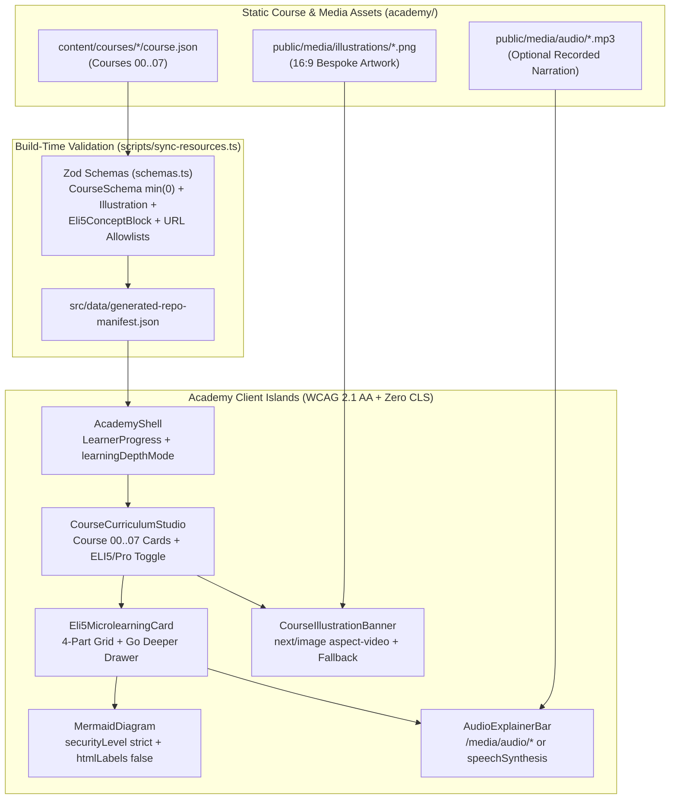
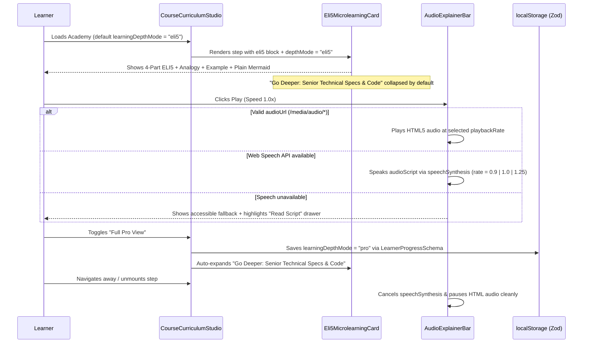

# Feature Spec: Antigravity Academy — ELI5 + 4-Part Microlearning + Multimodal Upgrade

**Status:** Locked (Pending Senior Engineer Sign-Off — Stage 2B)  
**Date:** 2026-11-25  
**Research & Design Inputs:** `.memory/architecture.md`, `plans/antigravity-academy-spec.md`, `.memory/decisions/0002-academy-nextjs-glassmorphic-architecture.md`, `.agents/rules/academy-invariants.md`, User Approved Design Decisions  
**ADR Reference:** `.memory/decisions/0003-eli5-multimodal-microlearning-architecture.md`

---

## 1. Overview & Goals

### Problem Statement
Antigravity Academy (`academy/`) delivers deep, production-grade engineering training across Courses 01–06, but assumes prior familiarity with terminals, Git, JSON schemas, hooks, and multi-agent terminology. Absolute beginners lack a zero-jargon starting ramp, and visual/auditory learners lack consistent plain-English mental models, everyday analogies, bite-sized microlearning structure, spoken audio explainers, bespoke illustrations, and plain-English diagrams on every lesson step.

### Target Users
1. **Zero-Experience Beginners ("Start Simple / ELI5"):** Learners with zero prior coding background who need everyday analogies, 4-part bite-sized lessons, plain-English diagrams, bespoke editorial visuals, and optional 30–60s spoken audio explainers before opening technical specifications.
2. **Practicing & Senior Engineers ("Full Pro View"):** Engineers who want instant access to the full technical takeaways, copyable code blocks, live repo artifacts, and parameterized Prompt Vault templates without losing depth.

### 8-Course Program Arc
| Order | Slug | Title / Role | Upgrade Scope | Execution Phase |
| :-: | :--- | :--- | :--- | :--- |
| **00** | `zero-to-one-foundations` | *Zero to One: Software, Terminals, Git & AI Harnesses Explained Simply* (New Beginner Ramp; zero prior coding experience assumed) | New 6-step course + 4 prompts + full ELI5 + 4-part + plain-English Mermaid + `audioScript` + bespoke illustration | **Phase 2 (Swarm Worker 1)** |
| **01** | `harness-mastery` | *Mastering the Agent Harness: Antigravity vs. Claude Code & Plugging the Gaps* | **Gold-Standard Pilot Upgrade:** `eli5Tagline`, bespoke illustration, 4-part `eli5` + `audioScript` + plain-English Mermaid on all 6 steps (preserving all senior content) | **Phase 1 (Pilot)** |
| **02** | `code-factory-sdlc` | *The Enterprise Code Factory: 8-Stage SDLC Reference Model* | Upgrade all existing steps to ELI5 + 4-part + plain-English Mermaid + `audioScript` + `eli5Tagline` + bespoke illustration | **Phase 2 (Swarm Worker 1)** |
| **03** | `pro-setup-playbook` | *Antigravity Pro Setup: Engineering & Content Playbook* | Upgrade all existing steps to ELI5 + 4-part + plain-English Mermaid + `audioScript` + `eli5Tagline` + bespoke illustration | **Phase 2 (Swarm Worker 2)** |
| **04** | `lit-software-factory` | *Lit Software Factories & Practical Loop Engineering* | Upgrade all existing steps to ELI5 + 4-part + plain-English Mermaid + `audioScript` + `eli5Tagline` + bespoke illustration | **Phase 2 (Swarm Worker 2)** |
| **05** | `notebooklm-antigravity` | *NotebookLM + Antigravity: Grounded Research, Media & Execution* | Upgrade all existing steps to ELI5 + 4-part + plain-English Mermaid + `audioScript` + `eli5Tagline` + bespoke illustration | **Phase 2 (Swarm Worker 3)** |
| **06** | `enterprise-product-video-studio` | *Pro Product Video Studio with Antigravity (Code-as-Video)* | Upgrade all existing steps to ELI5 + 4-part + plain-English Mermaid + `audioScript` + `eli5Tagline` + bespoke illustration | **Phase 2 (Swarm Worker 3)** |
| **07** | `orchestration-showcase` | *Subagents, Coordinators, Swarms, Teamwork & Boost* (New Living Meta-Build Case Study of This Exact Upgrade) | New 6-step meta-build case study + 4 prompts + full ELI5 + 4-part + plain-English Mermaid + `audioScript` + bespoke illustration | **Phase 2 (Swarm Worker 4)** |

### 1.1 Blueprints for New Courses (Self-Contained Authoring Scope)
- **Course 00 (`zero-to-one-foundations`, `level: "beginner"`, `accentTone: "emerald"`, `threeScenePreset: "sdlc-orbital"`):**
  1. *What Software Actually Is (Recipes, Ingredients & Kitchens)* — Files, folders, and programs explained with zero prior coding assumptions.
  2. *Your Workspace & Terminal (Talking to Your Computer Directly)* — Demystifying folders, terminal commands, and check scripts.
  3. *Git & Save Points (Time-Travel Undo for Everything You Build)* — Commits, branches, and safe teamwork without overwriting files.
  4. *AI Coding Assistants vs. The Harness (Brain vs. Workbench)* — Why the AI model is 10% and workspace rules, tools, and checks are 90%.
  5. *Rules, Skills & Safety Locks (Teaching AI Your House Rules)* — `AGENTS.md`, `skills/`, and human-approval safety gates in plain English.
  6. *Your First Guided Build Loop (From Idea to Checked Result)* — Plan → Build → Check → Save workflow preparing learners for Course 01, plus 4 beginner Prompt Vault cards.
- **Course 07 (`orchestration-showcase`, `level: "all-levels"`, `accentTone: "cyan"`, `threeScenePreset: "harness-constellation"`):**
  1. *Discovery Before Coding (`cf-research` + `cf-grill-me`)* — Inspecting existing constraints, backward compatibility, and choosing Phase 1 Pilot before Swarm fan-out.
  2. *Task 0: Freezing Shared Schemas & Contracts First* — Locking `schemas.ts` and `prompt-engine.ts` before launching parallel workers.
  3. *Subagents & Coordinators (Specialist Roles & Least Privilege)* — Why `cf-architect`, `cf-frontend`, `cf-backend`, `cf-tester`, and `cf-reviewer` stay cleanly separated.
  4. *Swarms, Teamwork & Zero-Overlap Partitions* — Running 4 parallel Swarm workers (`<= 5` concurrency cap) on disjoint course files and `image-generator` assets.
  5. *Boost Mode & Model Routing Economics* — Pairing high-reasoning `pro` models for specs/review with fast `flash` models for bounded parallel implementation and browser audits.
  6. *Decoupled Verification & The Outer Loop* — Enforcing the ELI5 Readability Rubric, `cf-eval` Output + Trajectory checks, and `375px / 768px / 1440px` visual QA before Stage 5 deploy, plus 4 orchestration Prompt Vault cards.

### Success Criteria
1. **100% Backward Compatibility During Incremental Rollout:** `Eli5ConceptBlockSchema`, `eli5Tagline`, `illustration`, and `audioUrl` are optional on `CourseSchema` / `LessonStepSchema`, and `learningDepthMode` defaults cleanly to `"eli5"` in `LearnerProgressSchema`, so Phase 1 compiles, syncs, and passes tests before Phase 2 modifies Courses 00 and 02–07.
2. **4-Part Microlearning + Progressive Disclosure:** Every upgraded step renders `1. Explain Like I'm 5`, `2. Why It Matters`, `3. Role in the Protocol`, and `4. How to Use It Going Forward`, flanked by an everyday analogy pill, concrete real-world example, `AudioExplainerBar`, plain-English `MermaidDiagram`, and a collapsible **"Go Deeper: Senior Technical Specs & Code"** drawer controlled globally by the **Start Simple (ELI5) / Full Pro View** toggle.
3. **Zero New Runtime Dependencies, Zero Secrets, Zero CVEs:** Uses existing Next.js (`next/image`), Lucide icons, Mermaid (`securityLevel: "strict"`, `htmlLabels: false`), Zod v4, Tailwind v4 `@theme` tokens, and native browser Web Speech API (`speechSynthesis`) / HTML5 `<audio>`.
4. **Strict Two-Phase Verification Gate:** Phase 1 Pilot passes `cf-tester`, `cf-reviewer` (including the ELI5 Readability Rubric), and `browser` visual QA (`375px`, `768px`, `1440px`) and receives **explicit user Pilot sign-off** before Phase 2 Swarm fan-out starts.

### Explicit Non-Goals
- No third-party paid TTS or runtime image-generation API integrations, server secrets, or database migrations.
- No removal or truncation of existing senior technical takeaways, code snippets, checklists, repo artifact pointers, or Prompt Vault cards.
- No edits to root Antigravity plugin discovery files (`plugin.json`, `hooks.json`, `rules/`, `skills/`, `agents/`, `hooks/`).
- No Phase 2 Swarm execution prior to explicit human sign-off on Phase 1 Pilot.

---

## 2. System Architecture

### Component & Build-Sync Boundaries



### Progressive-Disclosure & Audio Playback Sequence



---

## 3. API Contracts & Validation Schemas

All shared runtime schemas and inferred types live in `academy/src/lib/schemas.ts` (**Task 0**). Existing API Route Handlers (`GET /api/courses`, `GET /api/resources`, `POST /api/hitl/simulate`) preserve their request/response envelopes, `export const maxDuration = 10;`, and `PaginationQuerySchema` (`default limit=20`, `max limit=100`). Note: `GET /api/courses?limit=20&offset=0` automatically includes Courses `00` through `07` sorted ascending by `course.number`.

### 3.1 Exact Zod Schema Extensions (`academy/src/lib/schemas.ts`)

```ts
/**
 * Explicit allowlist for local editorial course illustrations (Security Invariant).
 * Prevents untrusted remote origins, javascript: URIs, or directory traversal.
 */
export const ALLOWED_IMAGE_URL_PATTERNS: readonly RegExp[] = [
  /^\/media\/illustrations\/[A-Za-z0-9._-]+\.(?:png|webp|jpg|jpeg|svg)$/,
];

/**
 * Explicit allowlist for local spoken audio explainers (Security Invariant).
 */
export const ALLOWED_AUDIO_URL_PATTERNS: readonly RegExp[] = [
  /^\/media\/audio\/[A-Za-z0-9._-]+\.(?:mp3|wav|ogg|m4a)$/,
];

export function isAllowedImageUrl(url: string): boolean {
  if (url.includes("..")) return false;
  return ALLOWED_IMAGE_URL_PATTERNS.some((pattern) => pattern.test(url));
}

export function isAllowedAudioUrl(url: string): boolean {
  if (url.includes("..")) return false;
  return ALLOWED_AUDIO_URL_PATTERNS.some((pattern) => pattern.test(url));
}

export const LearningDepthModeSchema = z.enum(["eli5", "pro"]);

export const CourseIllustrationSchema = z.object({
  src: z.string().min(1).refine(isAllowedImageUrl, {
    message:
      "Illustration src must match /media/illustrations/<filename>.(png|webp|jpg|jpeg|svg).",
  }),
  alt: z.string().min(1).max(280),
  caption: z.string().min(1).max(240),
  visualAnalogy: z.string().min(1).max(160),
});

export const Eli5ConceptBlockSchema = z.object({
  everydayAnalogy: z.string().min(1).max(160),
  simpleExplanation: z.string().min(1).max(500),       // Part 1: Explain Like I'm 5
  whyItMatters: z.string().min(1).max(500),            // Part 2: Why It Matters
  roleInProtocol: z.string().min(1).max(500),          // Part 3: Role in the Protocol & What It Delivers
  howToUseGoingForward: z.string().min(1).max(500),    // Part 4: How to Use It Going Forward
  realWorldExample: z.string().min(1).max(500),        // Concrete everyday example
  audioScript: z.string().min(1).max(1400),            // Warm 30-60s spoken narration script for the ear
  audioUrl: z
    .string()
    .refine(isAllowedAudioUrl, {
      message:
        "Audio URL must match /media/audio/<filename>.(mp3|wav|ogg|m4a).",
    })
    .optional(),
  estimatedMinutes: z.number().int().min(1).max(30).default(5),
  diagramCaption: z.string().min(1).max(240).optional(),
});
```

### 3.2 Updated Existing Schemas (`academy/src/lib/schemas.ts`)

1. **`LessonStepSchema`:** Add `eli5: Eli5ConceptBlockSchema.optional()` (preserving all existing required/optional fields).
2. **`CourseSchema`:**
   - Update `number: z.number().int().min(0)` (unlocks **Course 00**).
   - Add `eli5Tagline: z.string().min(1).max(260).optional()`.
   - Add `illustration: CourseIllustrationSchema.optional()`.
3. **`LearnerProgressSchema`:**
   - Add `learningDepthMode: LearningDepthModeSchema.default("eli5")`.
4. **Exported TypeScript Types:**
   - `export type LearningDepthMode = z.infer<typeof LearningDepthModeSchema>;`
   - `export type CourseIllustration = z.infer<typeof CourseIllustrationSchema>;`
   - `export type Eli5ConceptBlock = z.infer<typeof Eli5ConceptBlockSchema>;`
   - `export type Eli5ConceptBlockInput = z.input<typeof Eli5ConceptBlockSchema>;`

### 3.3 Boundary & Error Contracts
- **Build-Time Ingestion (`sync-resources.ts`):** Uses `CourseSchema.parse(parsedJson)`. Any invalid `illustration.src`, `eli5.audioUrl`, character-limit overflow, or `number < 0` fails `pnpm run sync:resources` immediately with path-scoped `ZodError` details before building.
- **API Route Handlers (`/api/courses`, `/api/resources`):** Unchanged structured JSON envelopes (`400 INVALID_QUERY`, `500 INTERNAL_ERROR`). `queryCourses` in `academy/src/lib/repository.ts` already sorts by `a.number - b.number`, placing Course 00 first automatically.
- **Defensive Client Guard (`CourseIllustrationBanner` & `AudioExplainerBar`):** Components re-check `isAllowedImageUrl` / `isAllowedAudioUrl` at render time so untrusted prop values in unit tests or malformed runtime payloads fall back safely without throwing or requesting external hosts.

---

## 4. Database & State Changes

### Client Persistence (`academy/src/lib/prompt-engine.ts`)
- **Storage Key:** `antigravity_academy_progress_v1` (unchanged—no breaking schema-version bump required).
- **Schema Upgrade (`LearnerProgressSchema`):**
  - Adds `learningDepthMode: "eli5" | "pro"` with `.default("eli5")`.
  - Existing learner records in `localStorage` lacking `learningDepthMode` safely hydrate as `"eli5"` through `LearnerProgressSchema.safeParse()`.
  - `createDefaultProgress(nowIso?)` returns `learningDepthMode: "eli5"`.
  - `normalizeProgress(progress)` preserves `learningDepthMode: progress.learningDepthMode`.
  - `parseImportedProgress(rawJson)` accepts both legacy v1 exports (defaulting `learningDepthMode` to `"eli5"`) and new exports containing `"eli5"` or `"pro"`, rejecting unknown values cleanly.

### Application State Plumbing (`academy/src/components/AcademyShell.tsx`)
- Add `handleChangeLearningDepthMode = useCallback((mode: LearningDepthMode) => { ... }, [])` updating `progress.learningDepthMode` and `updatedAt`.
- Pass `learningDepthMode={progress.learningDepthMode}` and `onChangeLearningDepthMode={handleChangeLearningDepthMode}` to `<CourseCurriculumStudio ... />`.

---

## 5. UI/UX & Accessibility Specs

### 5.1 Design System Adherence (`.agents/rules/academy-invariants.md`)
- **Zero literal hex colors in component markup or inline styles.** Strictly use Tailwind v4 `@theme` tokens from `academy/src/app/globals.css`:
  - Surfaces: `glass-panel`, `glass-panel-elevated`, `glass-pill`, `bg-void-950`, `bg-void-900`, `border-glass-border`
  - Accents: `text-cyan-glow`, `bg-cyan-deep` (`>= 5.70:1` contrast with `text-ink-primary`), `text-violet-glow`, `bg-violet-deep`, `text-emerald-glow`, `text-amber-glow`, `text-rose-glow`
  - Text contrast (`>= 4.5:1` WCAG 2.1 AA): `text-ink-primary`, `text-ink-secondary`, `text-ink-muted` on dark glass surfaces.
- **Valid WAI-ARIA Roles Only:** All mode toggles and speed selectors use `role="group"` + `aria-pressed` (never `role="tablist"` without paired `role="tabpanel"`).

### 5.2 Component Specifications

#### A. `academy/src/components/CourseIllustrationBanner.tsx`
- **Purpose:** Renders the bespoke 16:9 editorial artwork for a course with visual analogy badge, caption, and CLS-safe fallback states.
- **Props:**
  ```ts
  export interface CourseIllustrationBannerProps {
    courseTitle: string;
    accentTone?: "cyan" | "violet" | "emerald";
    illustration?: CourseIllustration;
    className?: string;
  }
  ```
- **Visual & Layout Behavior:**
  - Outer `<figure>` uses `glass-panel min-w-0 overflow-hidden rounded-2xl p-3`.
  - Artwork viewport uses `relative aspect-video w-full overflow-hidden rounded-xl border border-glass-border bg-void-950` (**zero CLS** across all states).
  - **Ready State** (`illustration` present, `isAllowedImageUrl(illustration.src)` true, no image error): Renders Next.js `<Image src={illustration.src} alt={illustration.alt} fill sizes="(max-width: 1024px) 100vw, 520px" unoptimized={illustration.src.endsWith(".svg")} className="object-cover" onError={() => setImageFailed(true)} />` with a subtle bottom gradient scrim (`from-void-950/90 via-void-950/30 to-transparent`) and a top-left `glass-pill` **Visual Analogy** pill (`illustration.visualAnalogy`). Below viewport, `<figcaption>` displays `illustration.caption` in `text-xs text-ink-secondary`.
  - **Error / Blocked URL State** (invalid URL or `onError`): Preserves exact `aspect-video` geometry inside `bg-void-900/80` showing an alert/fallback badge (`role="status"` or `role="alert"` for invalid URL), the `visualAnalogy` pill, and `illustration.alt` text so learners still grasp the metaphor without broken-image icons.
  - **Empty / Pending State** (`illustration === undefined`, e.g., Courses 02–06 during Phase 1 Pilot): Preserves `aspect-video` geometry with `cosmic-grid` backdrop, `Visual Analogy` pending badge, and `"Editorial Illustration Ready for Phase 2"` message.

#### B. `academy/src/components/AudioExplainerBar.tsx`
- **Purpose:** Interactive 30–60s spoken audio explainer bar embedded inside each `Eli5MicrolearningCard`.
- **Props:**
  ```ts
  export interface AudioExplainerBarProps {
    stepId: string;
    stepTitle: string;
    audioScript: string;
    audioUrl?: string;
    estimatedMinutes?: number;
  }
  ```
- **Playback Modes & Precedence:**
  1. If `audioUrl` is defined and `isAllowedAudioUrl(audioUrl)` is true, mount hidden `<audio ref={audioRef} src={audioUrl} preload="none" />` and play/pause/stop at `playbackRate = speed`. If `<audio>` triggers `onError`, smoothly fall back to Web Speech API (`speechSynthesis`) or script fallback state.
  2. Otherwise, use `window.speechSynthesis` + `SpeechSynthesisUtterance(audioScript)` with `utterance.rate = speed`. Capability check runs inside `useEffect` (`mounted` guard) so SSR and initial hydration match cleanly with zero hydration mismatch.
  3. If neither valid audio nor `window.speechSynthesis` is available (e.g., restricted browsers or jsdom without mock), disable Play button and display an accessible inline notice (`"Voice playback unavailable on this browser — read the script below"`) while keeping **"Read Script"** fully interactive.
- **Controls & State:**
  - Playback status: `"idle" | "playing" | "paused" | "error"`.
  - Primary **Play / Pause** button (`bg-cyan-deep text-ink-primary hover:bg-cyan-glow hover:text-void-950`, explicit `aria-label`).
  - **Stop** button (enabled when `"playing"` or `"paused"`, cancels `speechSynthesis` / resets `<audio>.currentTime = 0`).
  - **Speed Selector** (`role="group"`, `aria-label="Playback speed"`): `0.9x`, `1.0x`, `1.25x` with `aria-pressed`. Changing speed while speaking updates `<audio>.playbackRate` live, or cleanly restarts `speechSynthesis` at the new rate if currently playing.
  - **Expandable "Read Script" Drawer:** `<button type="button" aria-expanded={scriptOpen} aria-controls={`audio-script-${stepId}`}>` revealing the warm conversational `audioScript`.
  - **Unmount & Step-Change Cleanup (Mandatory):** `useEffect` cleanup cancels any active `window.speechSynthesis.cancel()` session initiated by the component and pauses `<audio>`. Ignore intentional `"canceled"` / `"interrupted"` error events on `utterance.onerror`.
  - `aria-live="polite"` status text (`Ready · ~45s`, `Playing at 1.0x`, `Paused`, `Stopped`).

#### C. `academy/src/components/Eli5MicrolearningCard.tsx`
- **Purpose:** Renders the 4-part microlearning breakdown for steps containing `step.eli5`, paired with progressive disclosure for technical depth.
- **Props:**
  ```ts
  export interface Eli5MicrolearningCardProps {
    step: LessonStep;
    eli5: Eli5ConceptBlock;
    learningDepthMode: LearningDepthMode;
    copiedSnippetKey: string | null;
    onCopySnippet: (snippetKey: string, code: string) => void;
    onJumpToPrompt: (promptId: string) => void;
    onJumpToResource: (relativePath: string) => void;
  }
  ```
- **Layout & Sections:**
  1. **Analogy & Duration Strip:** Displays `"Everyday Analogy"` badge (`eli5.everydayAnalogy`) + `~${eli5.estimatedMinutes ?? 5} min` badge.
  2. **Audio Explainer:** Embeds `<AudioExplainerBar />`.
  3. **4-Part Numbered Microlearning Grid (`grid-cols-1 gap-3 md:grid-cols-2`):**
     - **Card 1 (`border-cyan-glow/30`):** `1. Explain Like I'm 5` → `eli5.simpleExplanation`
     - **Card 2 (`border-violet-glow/30`):** `2. Why It Matters` → `eli5.whyItMatters`
     - **Card 3 (`border-emerald-glow/30`):** `3. Role in the Protocol` → `eli5.roleInProtocol`
     - **Card 4 (`border-amber-glow/30`):** `4. How to Use It Going Forward` → `eli5.howToUseGoingForward`
  4. **Real-World Example Callout:** Concise spotlight strip (`eli5.realWorldExample`).
  5. **Plain-English Visual Diagram (`step.mermaidDiagram`):** Always visible in both modes with `title={`Step ${step.order} Visual · ${step.title}`}` and `caption={eli5.diagramCaption ?? \`Plain-English flow for ${step.title}\`}`.
  6. **Collapsible "Go Deeper: Senior Technical Specs & Code" Drawer:**
     - Syncs initial/updated default state when `learningDepthMode` changes (`false` in `"eli5"`, `true` in `"pro"`), while permitting independent per-step expand/collapse clicks (`aria-expanded={goDeeperOpen}`, `aria-controls={`go-deeper-${step.id}`}`).
     - Contains: Senior Technical Summary (`step.summary`), Key Takeaways, Actionable Checklist, Code Snippets (`step.codeSnippet` + `step.additionalCodeSnippets`), and `Jump to Linked Prompt` / `Inspect Repo Artifact` action buttons.

#### D. `academy/src/components/CourseCurriculumStudio.tsx` (+ `PromptVault.tsx` Badge Polish)
- **Props Update (Backward Compatible):**
  - Add optional `learningDepthMode?: LearningDepthMode` and `onChangeLearningDepthMode?: (mode: LearningDepthMode) => void`. Resolve active mode via `learningDepthMode ?? progress.learningDepthMode ?? "eli5"` with local fallback state when `onChangeLearningDepthMode` is omitted (preserves all existing unit test calls).
- **Global Learning Depth Toggle:**
  - Place a prominent `role="group"` (`aria-label="Choose learning explanation depth"`) control in the Studio header:
    - Button 1: **Start Simple (ELI5)** (`aria-pressed={activeDepthMode === "eli5"}`)
    - Button 2: **Full Pro View** (`aria-pressed={activeDepthMode === "pro"}`)
- **Zero-Padded Course Numbering (`Course 00` Fix):**
  - Replace `Course 0{course.number}` / `COURSE 0{activeCourse.number}` with `Course ${String(course.number).padStart(2, "0")}` / `COURSE ${String(activeCourse.number).padStart(2, "0")}`.
  - Update the `"Expand Platform"` card heading to compute `nextCourseNumber = courses.reduce((max, c) => Math.max(max, c.number), -1) + 1` formatted as `Course ${String(nextCourseNumber).padStart(2, "0")}`.
  - In `PromptVault.tsx`, format badge text identically (`Course ${String(prompt.courseNumber).padStart(2, "0")}`).
- **Active Course Header + Illustration Layout:**
  - Pair Course metadata (zero-padded badge, level, tags, `activeCourse.eli5Tagline` when in `"eli5"` mode or `activeCourse.subtitle`, and Progress HUD) inside a responsive `lg:grid-cols-12` header card alongside `<CourseIllustrationBanner />` (`lg:col-span-5`) whenever `activeCourse.illustration` is defined.
  - When `activeCourse.illustration` is undefined on un-upgraded Courses 02–06 during Phase 1 Pilot, keep the clean full-width metadata card without inserting empty placeholder artwork banners across un-upgraded tracks (while `CourseIllustrationBanner` itself implements and unit-tests all 3 states: Ready, Error/Invalid URL, and Pending/Undefined).
- **Lesson Step Rendering & Legacy Fallback:**
  - When `step.eli5` is present: render `<Eli5MicrolearningCard ... />` inside the expanded step body (with concise `step.eli5.everydayAnalogy` subtitle chip on the accordion header in `"eli5"` mode).
  - When `step.eli5` is absent (Courses 02–06 during Phase 1 Pilot and legacy test fixtures): render the classic Takeaways, Checklist, Code Snippets, Mermaid Diagram, and Prompt/Artifact buttons directly (100% preserving `components.test.tsx` assertions) plus a subtle `glass-pill` notice: `"Classic Pro View — ELI5 Beginner Guide arriving in Phase 2"`.

### 5.3 Loading, Error, Empty & Responsive Matrix (WCAG 2.1 AA)
| Component | Loading State | Error State | Empty / Fallback State | Responsive (`375px / 768px / 1440px`) |
| :--- | :--- | :--- | :--- | :--- |
| **`CourseIllustrationBanner`** | Fixed `aspect-video` dark canvas (`bg-void-950`) preventing CLS | Safe `aspect-video` fallback card displaying `visualAnalogy` + `alt` text (`role="alert"` for invalid URL) | `aspect-video` cosmic-grid slate showing `"Editorial Illustration Pending"` | Single-column full-width at `375px`/`768px`; 5-col companion beside header at `1440px` |
| **`AudioExplainerBar`** | Hydrates client speech capability post-mount (zero SSR mismatch) | Audio file load failure falls back cleanly to `speechSynthesis` or script notice | Non-speech environments disable Play & show `"Read Script"` guidance | Stacked controls with `flex-wrap` at `375px`; single inline toolbar at `768px`/`1440px` |
| **`Eli5MicrolearningCard`** | Immediate synchronous render from manifest | Mermaid failure delegates to `MermaidDiagram` error + raw source toggle | Uses `estimatedMinutes ?? 5` and omits optional audio/diagram cleanly if absent | 1-col stacked 4 parts (`375px`) -> 2x2 grid (`768px`/`1440px`), zero horizontal overflow |

---

## 6. Selective Autonomy, Verification Oracles & ELI5 Readability Rubric

### 6.1 Selective Autonomy Classification (`rules/AGENTS.md` §8)
| Task Class | Tier | Rationale & Required Human / Oracle Gate |
| :--- | :--- | :--- |
| **Task 0: `schemas.ts` & `LearnerProgressSchema` Contract** | **Human-Lit** | Core architectural & data boundary contract locked in Stage 2B before implementation. |
| **UI Components (`CourseIllustrationBanner`, `AudioExplainerBar`, `Eli5MicrolearningCard`, `CourseCurriculumStudio`)** | **Lights-Out Build -> Human-Lit Visual Review** | Crisp automated oracles (`tsc`, `eslint`, `vitest`) + decoupled `cf-reviewer` & `browser` (`375/768/1440px`) audit; Pilot requires explicit human sign-off. |
| **Course JSON Content Bundles (`00`–`07`)** | **Lights-Out (Bounded Swarm `<= 4` Workers)** | Strict Zod validation via `sync:resources` + independent `cf-reviewer` ELI5 Readability Rubric grading. |
| **Course Illustrations (`image-generator`)** | **Lights-Out Generation -> Visual Browser Audit** | Allowlist-checked static assets inspected visually in `browser` subagent for crop, contrast, and zero text glitches. |
| **Unit & Component Tests (`cf-tester`)** | **Lights-Out (Decoupled Context)** | Deterministic Vitest + Testing Library; zero skipped tests, zero mocked domain validators. |
| **Staging / Production Deploy (`cf-deploy-staging`)** | **Human-Lit Mandatory** | Always gated by Stage 4 `.memory/qa-report.md` + explicit human HITL confirmation. |

### 6.2 Automated Verification Oracles (Both Phase 1 & Phase 2)
1. `cd academy && pnpm run sync:resources` → exits `0`, prints validated resource & course counts, zero `ZodError`.
2. `cd academy && pnpm run typecheck` (`tsc --noEmit`) → `0` errors.
3. `cd academy && pnpm run lint` (`next lint`) → `0` errors, `0` warnings.
4. `cd academy && pnpm test` (`vitest run`) → `100%` pass across `hitl-evaluator`, `schemas-and-prompts`, `api-routes`, and `components` suites.
5. `cd academy && pnpm run build` → clean production Next.js build.
6. `bash skills/cf-next-verify/scripts/verify-stack.sh academy --coverage` → `0` `NEXT_PUBLIC_*` secret leaks, `0` `service_role` client references, `0` `as any`.
7. **Live Browser Verification (`browser` subagent):** Audit rendered pages at **`375px`**, **`768px`**, and **`1440px`** verifying zero console/page errors, zero horizontal overflow, clean SVG Mermaid graphs, working ELI5/Pro toggle, AudioExplainerBar controls, and Course Illustration rendering.

### 6.3 ELI5 Readability Rubric (Enforced by `cf-reviewer` Dual-Axis Eval)
During Stage 4 QA (`cf-qa-review` + `cf-eval`), decoupled `cf-reviewer` MUST inspect every upgraded course against all 7 criteria before clearing Stage 4:

| # | Criterion | Pass Standard | Automatic Fail Trigger |
| :-: | :--- | :--- | :--- |
| **1** | **Zero Undefined Jargon in Part 1** | `simpleExplanation` (Part 1) uses everyday words readable by a smart 10–12 year old with zero coding experience; any unavoidable technical term is immediately translated in plain words. | Unexplained acronyms/terms (`CI/CD`, `AST`, `IPC`, `deterministic`, `hydration`, `RLS`, `sandbox`, `stdout`) in Part 1. |
| **2** | **Concrete Everyday Analogy** | `everydayAnalogy` maps the technical mechanism to a physical, relatable real-world object or situation (e.g., *a checklist taped to a kitchen fridge*, *a bouncer checking IDs*). | Abstract metaphor, tautology, or exceeds 160 chars. |
| **3** | **All 4 Microlearning Parts Distinct & Complete** | `simpleExplanation` (What it is), `whyItMatters` (Why care / pain solved), `roleInProtocol` (How it fits the bigger Code Factory system & delivers value), and `howToUseGoingForward` (Concrete next habit) each play their distinct role. | Repeated sentences across parts or missing/generic advice. |
| **4** | **100% Plain-English Mermaid Diagram per Upgraded Step** | Every upgraded step contains `mermaidDiagram` written in plain-English labels (understandable without coding knowledge), wrapped in quotes, zero HTML tags (`<br/>`, `<b>`) per `htmlLabels: false`. | Any upgraded step missing `mermaidDiagram`, raw code/flag labels in ELI5 nodes, or XML/SVG parse error. |
| **5** | **Warm, Ear-First `audioScript`** | Written in natural spoken cadence (contractions allowed, short sentences, ~75–180 words / 30–60s), free of markdown syntax (`**`, `` ` ``, `#`, URLs) that sounds awkward when read aloud by `speechSynthesis`. | Raw markdown/backticks/URLs inside `audioScript` or robotic bullet reading. |
| **6** | **Visual Artwork & Alt Accessibility** | `illustration` uses an allowlisted `/media/illustrations/<slug>.png|webp|jpg|jpeg|svg` asset that exists on disk in `academy/public/`, renders inside `aspect-video` without clipping, and has descriptive `alt`, `caption`, and `visualAnalogy`. | Missing file on disk, broken image, generic alt (`"image"`), or CLS jump. |
| **7** | **Design Tokens & WCAG 2.1 AA Integrity** | Zero hardcoded hex colors in TSX, contrast `>= 4.5:1` on all text/badges, valid WAI-ARIA (`role="group"` + `aria-pressed`), and `"Go Deeper"` drawer preserves 100% of original technical takeaways/code/prompts. | Hardcoded hex in components, contrast `< 4.5:1`, invalid `role="tablist"`, or deleted senior content. |

---

## 7. Atomic Task Breakdown (Non-Overlapping File Partitions)

Execution is strictly split into **Phase 1 (Pilot)** and **Phase 2 (Swarm Fan-Out)**. No two concurrent workers ever edit the same file.

### Phase 1: Pilot Build & Verification (Wait for User Pilot Sign-Off After Task 1C)

- [ ] **Task 0 (Shared Contracts & State — Prerequisite, `cf-backend`):**
  - `academy/src/lib/schemas.ts` (`CourseSchema.number.min(0)`, `ALLOWED_IMAGE_URL_PATTERNS`, `ALLOWED_AUDIO_URL_PATTERNS`, `isAllowedImageUrl`, `isAllowedAudioUrl`, `CourseIllustrationSchema`, `Eli5ConceptBlockSchema`, `LearningDepthModeSchema`, `LessonStepSchema.eli5`, `CourseSchema.eli5Tagline` & `illustration`, `LearnerProgressSchema.learningDepthMode`)
  - `academy/src/lib/prompt-engine.ts` (`createDefaultProgress` & `normalizeProgress` support `learningDepthMode`)
  - `academy/src/components/AcademyShell.tsx` (wire `learningDepthMode` state + `handleChangeLearningDepthMode` into `<CourseCurriculumStudio />`)

- [ ] **Task 1A (Multimodal Progressive-Disclosure UI — `cf-frontend`, runs after Task 0):**
  - `academy/src/components/CourseIllustrationBanner.tsx` (new)
  - `academy/src/components/AudioExplainerBar.tsx` (new)
  - `academy/src/components/Eli5MicrolearningCard.tsx` (new)
  - `academy/src/components/CourseCurriculumStudio.tsx` (global ELI5/Pro toggle, `padStart(2, "0")` badges, integration of 3 new components + legacy step fallback)
  - `academy/src/components/PromptVault.tsx` (zero-padded `Course ${String(prompt.courseNumber).padStart(2, "0")}` badge)

- [ ] **Task 1B (Course 01 Pilot Content & Bespoke Artwork — Content + `image-generator`, runs in parallel with 1A after Task 0):**
  - `academy/public/media/illustrations/harness-mastery.png` (new bespoke 16:9 glassmorphic editorial illustration via `image-generator`)
  - `academy/content/courses/harness-mastery/course.json` (`eli5Tagline`, `illustration`, full 4-part `eli5` + warm `audioScript` + plain-English `mermaidDiagram` across all 6 steps; all existing senior content preserved)

- [ ] **Task 1C (Pilot Synthesis & Decoupled QA — Orchestrator → `cf-tester` → `cf-reviewer` + `browser`):**
  - Orchestrator runs `pnpm run sync:resources` → updates `academy/src/data/generated-repo-manifest.json`
  - `cf-tester` expands `academy/tests/schemas-and-prompts.test.ts` & `academy/tests/components.test.tsx` (covering URL allowlists, `number: 0`, `learningDepthMode` defaults, all states of `CourseIllustrationBanner`, `AudioExplainerBar` incl. unmount cancellation & speech fallback, `Eli5MicrolearningCard` 4-part + Go Deeper drawer, and `CourseCurriculumStudio` toggle + fallback)
  - `cf-reviewer` runs Dual-Axis Eval + ELI5 Readability Rubric on Course 01 & UI diff; `browser` subagent visually audits `375px`, `768px`, and `1440px`
  - **HUMAN PILOT GATE:** Present live Pilot screenshots & QA report to user and **stop for explicit Pilot sign-off** before launching Phase 2.

---

### Phase 2: Swarm Fan-Out (4 Concurrent Workers `<= 5` Cap — Only After Pilot Approval)

Each Swarm worker operates strictly inside its assigned course JSON and illustration file—zero shared TypeScript or manifest edits during fan-out:

- [ ] **Task 2A (`cf-swarm-1` — Courses 00 & 02):**
  - `academy/content/courses/zero-to-one-foundations/course.json` (new Course 00: 6 beginner steps, 4 prompts, full ELI5 + 4-part + plain-English Mermaid + `audioScript`)
  - `academy/public/media/illustrations/zero-to-one-foundations.png` (via `image-generator`)
  - `academy/content/courses/code-factory-sdlc/course.json` (Course 02 ELI5 + 4-part + plain-English Mermaid + `audioScript` upgrade)
  - `academy/public/media/illustrations/code-factory-sdlc.png` (via `image-generator`)

- [ ] **Task 2B (`cf-swarm-2` — Courses 03 & 04):**
  - `academy/content/courses/pro-setup-playbook/course.json` (Course 03 ELI5 + 4-part + plain-English Mermaid + `audioScript` upgrade)
  - `academy/public/media/illustrations/pro-setup-playbook.png` (via `image-generator`)
  - `academy/content/courses/lit-software-factory/course.json` (Course 04 ELI5 + 4-part + plain-English Mermaid + `audioScript` upgrade)
  - `academy/public/media/illustrations/lit-software-factory.png` (via `image-generator`)

- [ ] **Task 2C (`cf-swarm-3` — Courses 05 & 06):**
  - `academy/content/courses/notebooklm-antigravity/course.json` (Course 05 ELI5 + 4-part + plain-English Mermaid + `audioScript` upgrade)
  - `academy/public/media/illustrations/notebooklm-antigravity.png` (via `image-generator`)
  - `academy/content/courses/enterprise-product-video-studio/course.json` (Course 06 ELI5 + 4-part + plain-English Mermaid + `audioScript` upgrade)
  - `academy/public/media/illustrations/enterprise-product-video-studio.png` (via `image-generator`)

- [ ] **Task 2D (`cf-swarm-4` — Course 07 Orchestration Showcase):**
  - `academy/content/courses/orchestration-showcase/course.json` (new Course 07: *Subagents, Coordinators, Swarms, Teamwork & Boost* — 6 meta-build steps documenting this exact upgrade, 4 prompts, full ELI5 + 4-part + plain-English Mermaid + `audioScript`)
  - `academy/public/media/illustrations/orchestration-showcase.png` (via `image-generator`)

- [ ] **Task 2E (Post-Swarm Orchestrator Synthesis & Full Decoupled QA):**
  - Orchestrator runs `cd academy && pnpm run sync:resources` ONCE → generates unified `academy/src/data/generated-repo-manifest.json` (`8` courses: `00`–`07`)
  - `cf-tester` updates `academy/tests/api-routes.test.ts` (asserting 8 courses sorted `0..7` including `zero-to-one-foundations` and `orchestration-showcase`) and runs full `verify-stack.sh academy --coverage`
  - `cf-reviewer` audits all 8 courses against the 7-point ELI5 Readability Rubric + Dual-Axis Eval and writes `.memory/qa-report.md`
  - `browser` subagent visually verifies all 8 courses, illustrations, audio bars, Mermaid SVGs, and `375px` / `768px` / `1440px` responsiveness before Stage 5 HITL deploy approval.

---

## 8. Senior Engineer Sign-Off (Stage 2 Gate)
- [ ] Spec is completely self-contained with zero implicit assumptions.
- [ ] Zod schemas (`CourseSchema`, `Eli5ConceptBlockSchema`, `CourseIllustrationSchema`, `LearnerProgressSchema`, allowlist guards) include full runtime bounds and backward compatibility.
- [ ] Task breakdown enforces Task 0 prerequisite, Phase 1 Pilot gate, and zero-overlap Phase 2 Swarm partitions (`<= 4` concurrent workers).
- [ ] ELI5 Readability Rubric and decoupled QA criteria (`cf-tester`, `cf-reviewer`, `browser`) are explicitly defined.
