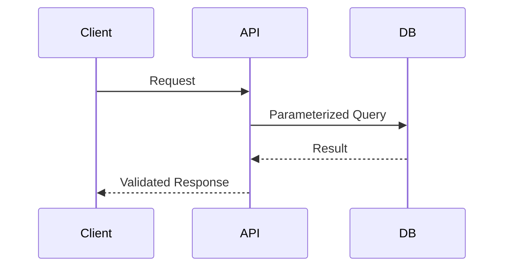

# Feature Spec: [Feature Name]

**Status:** Draft | Locked (Approved)  
**Date:** YYYY-MM-DD  
**Research Input:** `.memory/research.md`  

## 1. Overview & Goals
- Problem statement, target users, and explicit non-goals.

## 2. System Architecture

## 3. API Contracts & Validation Schemas
- Endpoints / RPC signatures, request/response schemas (Zod/Pydantic/JSON Schema), pagination defaults/max limits, auth requirements, and error codes.

## 4. Database & State Changes
- Schema migrations, new tables/columns, foreign keys, and required indexes.

## 5. UI/UX & Accessibility Specs
- Component hierarchy, design tokens, Loading / Error / Empty states, responsive breakpoints (375px / 768px / 1440px), and WCAG 2.1 AA requirements.

## 6. Security, Scalability & Testing Checklist
- Input validation, auth middleware, timeout/retry limits, deterministic unit/integration tests, and edge cases.

## 7. Atomic Task Breakdown (Non-Overlapping File Partitions)
- [ ] **Task 0 (Shared Interfaces First):** `src/types/...`
- [ ] **Task 1 (Backend):** `src/backend/...`
- [ ] **Task 2 (Frontend):** `src/frontend/...`
- [ ] **Task 3 (Tests):** `tests/...`

## 8. Senior Engineer Sign-Off
- [ ] Spec is self-contained with zero implicit assumptions.
- [ ] API contracts include validation schemas and error codes.
- [ ] Task checklist is decomposed into atomic, non-overlapping subagent actions.
